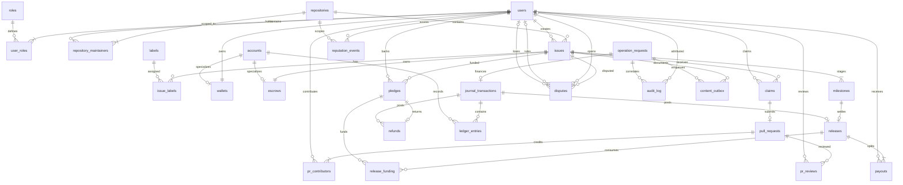

# 1. Overview and Goals

**Project:** Collaborative Bug & Feature Request Platform with Bounty Payouts. **Specification version:** 2.0, 27 October 2026.

| Item | Requirement |
|---|---|
| Goal | Let repository maintainers publish bugs and feature requests, contributors claim and resolve them through reviewed PRs, and backers fund their completion. |
| Financial success | Every committed operation preserves issue conservation, wallet reconciliation, balanced journal transactions, and nonnegative wallet and escrow balances. |
| Technology | MySQL 8.0, InnoDB, relational 3NF; MongoDB 7 document storage; INR only; monetary values DECIMAL(12,2). |
| Demo scale | Exactly 15 users, 4 repositories, 30 issues, 40 pledges, and 20 PRs at the seed checkpoint. |
| Included | Users and roles, wallets and ledger, repositories, issues, escrow, pledges, payouts, the ten numbered features, reports, content documents, audit records, a responsive React frontend, an authenticated Express REST API, and local Docker setup. |
| Non-goals and out-of-scope list | External payments, withdrawals to banks, foreign exchange, platform fees, OAuth, Git hosting integration, email, notifications, attachments, issue dependencies, auctions, contributor discovery, and production deployment. |
| Delivery boundary | The user has authorized implementation of the complete local application, including frontend, backend API, both databases, seed data, and tests; progress.md records checkpoints and verification. |

An issue is resolved by a reviewed, merged PR and final settlement. Feature 10 explicitly permits intermediate milestone payments before whole-issue resolution; each such payment requires a merged PR and a maintainer's milestone achievement decision. This is the bounded milestone interpretation of the general completion-before-payment rule; it does not permit advances before an accepted PR.

# 2. Actors and Permissions

Roles are additive. MAINTAINER privileges require a row in `repository_maintainers` for the target repository. ADMIN is not an implicit maintainer, contributor, or backer. The calling service verifies the session's user and passes that identity to MySQL; clients cannot select another actor. SYSTEM is the database event executor or trusted content worker, not a fifth user role.

| Action | ADMIN | MAINTAINER | CONTRIBUTOR | BACKER | SYSTEM |
|---|---|---|---|---|---|
| Create user; grant additive roles | Yes | No | No | No | No |
| Create repository; assign maintainers; set approvals 1–3 | Yes | No | No | No | No |
| Credit a user's wallet with a top-up | Yes | No | No | No | No |
| Read issue details, labels, milestones, public content, reports, reputation | Yes | Yes | Yes | Yes | Read for jobs |
| Read own wallet and ledger | Own | Own | Own | Own | Reconcile |
| Read all wallets, audit log, reconciliation results | Yes | No | No | No | Reconcile |
| Create issue; set issue kind, difficulty, labels; edit body | No | Scoped | No | No | Apply queued body |
| Configure milestone percentages before funding | No | Scoped | No | No | No |
| Extend bounty deadline once; close issue | No | Scoped | No | No | Execute expiry policy |
| Claim issue; submit PR and contributor shares | No | No | Own claim | No | Expire claims |
| Replace submitted PR's shares before merge | No | No | PR author | No | No |
| Approve or request changes with review comments | No | Scoped, not a PR contributor | No | No | No |
| Reject PR; merge PR | No | Scoped; merger/rejector not a PR contributor | No | No | No |
| Achieve intermediate milestone; resolve issue/final milestone | No | Scoped; not a PR contributor | No | No | No |
| Create pledge; voluntarily refund eligible own pledge | No | No | No | Own wallet | No |
| Open dispute | Eligible participant | Eligible participant | Eligible participant | Eligible participant | No |
| Rule on dispute; designate losing participant | Yes, not a party | No | No | No | No |
| Add comment, reply, or code snippet | Yes | Yes | Yes | Yes | Apply queued content |
| Append commit log to submitted PR | No | No | PR author | No | Apply queued content |
| Process deadline refunds | No | No | No | No | Yes |
| Append accounts, operation results, journals, ledger, release funding, releases, refunds, payouts, reputation, audit, outbox records | Through authorized routines | Through authorized routines | Through authorized routines | Through authorized routines | Through authorized routines |
| Deliver/retry content outbox and read worker backlog | Read backlog | No | No | No | Yes |
| Execute demonstration, test, seed reset, and reconciliation | Isolated demo database operator | No | No | No | Reconciliation only |

An eligible dispute participant is any recorded pledger, historical claimant, or PR author of the issue, irrespective of that participant's current role. No user may directly insert, update, or delete financial or audit tables. Role revocation, user deletion, repository deletion, and user-to-user wallet transfers are outside scope.

# 3. Glossary

| Term | Definition |
|---|---|
| Pledge | An accepted wallet-to-escrow transfer of at least INR 10.00; its original amount remains immutable after a refund. |
| Escrow | Exactly one issue-owned account holding accepted funds that have not been paid or refunded. |
| Release | One atomic settlement of a milestone into one or more contributor payouts. |
| Funding attribution | `release_funding` records identifying how much of each pledge funded a release. |
| Held pledge balance | `pledges.amount` minus that pledge's release funding minus its refunds. |
| Claim | Exclusive seven-day opportunity to submit one PR for an issue. |
| Outstanding change-request | The latest review for a reviewer is REQUEST_CHANGES. |
| Resolution time | Seconds between `issues.created_at` and `issues.resolved_at`; credited to every contributor of the merged PR. |
| Freeze | A dispute flag and FROZEN escrow status preventing pledge acceptance, withdrawals, releases, refunds, claim creation/expiry, PR submission/share edits/final rejection/merge, resolution, closure, deadline extension, relational metadata edits, and milestone reconfiguration. |
| External issuance | An ADMIN-authorized top-up, explicitly balanced against a non-spendable ISSUANCE account. |
| Operation key | A caller's UUID identifying one request; the same actor, key, and payload returns the saved result. |
| Metric scope | One repository, or the union of all four repositories for a global result. |
| Basis points | Integer percentage hundredths; 100.00 percent equals 10,000 basis points. |

# 4. Domain Model

## Dictionary conventions

All tables use InnoDB. All FKs use RESTRICT for updates and deletes. `BIGINT UNSIGNED` identifiers are positive. All times are UTC `DATETIME(6)`. `none` means no default: the routine supplies the field. PK means primary key, UK means unique key, FK means foreign key, and CK names a check constraint. A composite PK is identified on every participating field. Optional timestamps are NULL until the described event. Monetary signed entries use DECIMAL(12,2); account balances never use signed ledger entries as their balance type semantics.

### users

| Attribute | SQL type | Nullable | Default | Key | Constraint | Description |
|---|---|---|---|---|---|---|
| user_id | BIGINT UNSIGNED | No | AUTO_INCREMENT | PK | Positive | User identifier |
| display_name | VARCHAR(80) | No | none | — | Length 1–80 | Public name |
| email | VARCHAR(254) | No | none | UK | Lowercase, unique | Login identity |
| password_hash | VARCHAR(255) | No | none | — | scrypt salt and derived hash | Server-only credential |
| created_at | DATETIME(6) | No | CURRENT_TIMESTAMP(6) | — | UTC | Registration time |

### roles

| Attribute | SQL type | Nullable | Default | Key | Constraint | Description |
|---|---|---|---|---|---|---|
| role_code | VARCHAR(11) | No | none | PK | ADMIN, MAINTAINER, CONTRIBUTOR, BACKER | Closed role set |

### user_roles

| Attribute | SQL type | Nullable | Default | Key | Constraint | Description |
|---|---|---|---|---|---|---|
| user_id | BIGINT UNSIGNED | No | none | PK, FK users | Composite PK | Role holder |
| role_code | VARCHAR(11) | No | none | PK, FK roles | Composite PK | Assigned role |

### repositories

| Attribute | SQL type | Nullable | Default | Key | Constraint | Description |
|---|---|---|---|---|---|---|
| repository_id | BIGINT UNSIGNED | No | AUTO_INCREMENT | PK | Positive | Repository identifier |
| repository_name | VARCHAR(100) | No | none | UK | Length 1–100 | Repository name |
| required_approvals | TINYINT UNSIGNED | No | 1 | — | ck_required_approvals: 1–3 | Merge threshold |
| created_at | DATETIME(6) | No | CURRENT_TIMESTAMP(6) | — | UTC | Creation time |

### repository_maintainers

| Attribute | SQL type | Nullable | Default | Key | Constraint | Description |
|---|---|---|---|---|---|---|
| repository_id | BIGINT UNSIGNED | No | none | PK, FK repositories | Composite PK | Maintained repository |
| user_id | BIGINT UNSIGNED | No | none | PK, FK users | MAINTAINER role required by routine | Scoped maintainer |

### labels

| Attribute | SQL type | Nullable | Default | Key | Constraint | Description |
|---|---|---|---|---|---|---|
| label_id | BIGINT UNSIGNED | No | AUTO_INCREMENT | PK | Positive | Label identifier |
| label_name | VARCHAR(40) | No | none | UK | Length 1–40 | Global reusable label |

### issues

| Attribute | SQL type | Nullable | Default | Key | Constraint | Description |
|---|---|---|---|---|---|---|
| issue_id | BIGINT UNSIGNED | No | AUTO_INCREMENT | PK | Positive | Issue identifier |
| repository_id | BIGINT UNSIGNED | No | none | FK repositories | Required | Owning repository |
| created_by | BIGINT UNSIGNED | No | none | FK users | Scoped maintainer | Creator |
| title | VARCHAR(200) | No | none | — | Length 1–200 | Search/display title |
| issue_kind | VARCHAR(7) | No | none | — | BUG, FEATURE | Request kind |
| difficulty | VARCHAR(6) | No | none | — | EASY, MEDIUM, HARD | Reputation multiplier input |
| status | VARCHAR(9) | No | OPEN | — | OPEN, CLAIMED, IN_REVIEW, RESOLVED, CLOSED | Base lifecycle |
| is_disputed | BOOLEAN | No | FALSE | — | Matches one open dispute | Orthogonal freeze flag |
| created_at | DATETIME(6) | No | CURRENT_TIMESTAMP(6) | — | UTC | Creation time |
| bounty_deadline | DATETIME(6) | No | none | — | Initially created_at + 60 days | Funding and settlement deadline |
| deadline_extended | BOOLEAN | No | FALSE | — | Once-only extension marker | Extension adds 30 days |
| resolved_at | DATETIME(6) | Yes | NULL | — | Non-NULL iff RESOLVED | Resolution time |

The historical existence of a claim determines whether an issue was ever claimed; no duplicate `ever_claimed` attribute is stored. Difficulty, repository, and issue kind become immutable at the first claim.

### issue_labels

| Attribute | SQL type | Nullable | Default | Key | Constraint | Description |
|---|---|---|---|---|---|---|
| issue_id | BIGINT UNSIGNED | No | none | PK, FK issues | Composite PK | Labeled issue |
| label_id | BIGINT UNSIGNED | No | none | PK, FK labels | Composite PK | Attached label |

### accounts

| Attribute | SQL type | Nullable | Default | Key | Constraint | Description |
|---|---|---|---|---|---|---|
| account_id | BIGINT UNSIGNED | No | AUTO_INCREMENT | PK | Positive | Journal account |
| account_kind | VARCHAR(8) | No | none | — | WALLET, ESCROW, ISSUANCE | Disjoint account specialization |
| issuance_slot | TINYINT UNSIGNED | Yes | generated | UK | 1 for ISSUANCE, NULL otherwise | Enforces one issuance account |

### wallets

| Attribute | SQL type | Nullable | Default | Key | Constraint | Description |
|---|---|---|---|---|---|---|
| user_id | BIGINT UNSIGNED | No | none | PK, FK users | One wallet per user | Wallet owner |
| account_id | BIGINT UNSIGNED | No | none | UK, FK accounts | WALLET kind | Journal account |
| balance | DECIMAL(12,2) | No | 0.00 | — | ck_wallet_balance: >= 0 | Cached sum of signed entries |

### escrows

| Attribute | SQL type | Nullable | Default | Key | Constraint | Description |
|---|---|---|---|---|---|---|
| issue_id | BIGINT UNSIGNED | No | none | PK, FK issues | Created with issue | Exactly one escrow per issue |
| account_id | BIGINT UNSIGNED | No | none | UK, FK accounts | ESCROW kind | Journal account |
| held_amount | DECIMAL(12,2) | No | 0.00 | — | ck_escrow_held: >= 0 | Cached sum of signed entries |
| status | VARCHAR(7) | No | ACTIVE | — | ACTIVE, FROZEN, SETTLED | Financial lifecycle |

### claims

| Attribute | SQL type | Nullable | Default | Key | Constraint | Description |
|---|---|---|---|---|---|---|
| claim_id | BIGINT UNSIGNED | No | AUTO_INCREMENT | PK | Positive | Claim attempt |
| issue_id | BIGINT UNSIGNED | No | none | FK issues | Required | Claimed issue |
| claimant_id | BIGINT UNSIGNED | No | none | FK users | CONTRIBUTOR role | Claimant |
| status | VARCHAR(9) | No | ACTIVE | — | ACTIVE, SUBMITTED, COMPLETED, EXPIRED, CANCELLED | Claim lifecycle |
| claimed_at | DATETIME(6) | No | CURRENT_TIMESTAMP(6) | — | UTC | Lock start |
| expires_at | DATETIME(6) | No | none | — | claimed_at + 7 days | Submission cutoff |
| active_issue_id | BIGINT UNSIGNED | Yes | generated | UK | issue_id for ACTIVE/SUBMITTED, NULL otherwise | active_issue_id unique index |

### pull_requests

| Attribute | SQL type | Nullable | Default | Key | Constraint | Description |
|---|---|---|---|---|---|---|
| pr_id | BIGINT UNSIGNED | No | AUTO_INCREMENT | PK | Positive | Internal PR identifier |
| claim_id | BIGINT UNSIGNED | No | none | UK, FK claims | One PR per claim | Issue and author derive from claim |
| title | VARCHAR(200) | No | none | — | Length 1–200 | PR title |
| status | VARCHAR(9) | No | SUBMITTED | — | SUBMITTED, MERGED, REJECTED, CANCELLED | Review lifecycle |
| submitted_at | DATETIME(6) | No | CURRENT_TIMESTAMP(6) | — | Before claim cutoff | Submission time |
| merged_at | DATETIME(6) | Yes | NULL | — | Non-NULL iff MERGED | Acceptance time |
| share_revision | INT UNSIGNED | No | 1 | — | Positive; increments on share replacement | Review eligibility version |

### pr_contributors

| Attribute | SQL type | Nullable | Default | Key | Constraint | Description |
|---|---|---|---|---|---|---|
| pr_id | BIGINT UNSIGNED | No | none | PK, FK pull_requests | Composite PK | Shared PR |
| user_id | BIGINT UNSIGNED | No | none | PK, FK users | CONTRIBUTOR role | Payee |
| share_percent | DECIMAL(5,2) | No | none | — | ck_share_percent: > 0 and <= 100 | All rows total 100.00 |

### pr_reviews

| Attribute | SQL type | Nullable | Default | Key | Constraint | Description |
|---|---|---|---|---|---|---|
| review_id | BIGINT UNSIGNED | No | AUTO_INCREMENT | PK | Positive | Append-only review event |
| pr_id | BIGINT UNSIGNED | No | none | FK pull_requests | SUBMITTED PR | Reviewed PR |
| reviewer_id | BIGINT UNSIGNED | No | none | FK users | Scoped non-contributor maintainer | Reviewer |
| decision | VARCHAR(15) | No | none | — | APPROVE, REQUEST_CHANGES | Latest event controls reviewer vote |
| comment_text | VARCHAR(2000) | No | none | — | Length 1–2000 | Required review explanation |
| share_revision | INT UNSIGNED | No | none | — | Matches current PR revision when written | Version reviewed |
| created_at | DATETIME(6) | No | CURRENT_TIMESTAMP(6) | — | UTC | Review time |

### milestones

| Attribute | SQL type | Nullable | Default | Key | Constraint | Description |
|---|---|---|---|---|---|---|
| milestone_id | BIGINT UNSIGNED | No | AUTO_INCREMENT | PK | Positive | Milestone identifier |
| issue_id | BIGINT UNSIGNED | No | none | FK issues | UK(issue_id, sequence_no) | Owning issue |
| sequence_no | SMALLINT UNSIGNED | No | none | UK component | Contiguous 1–10 | Release order; largest is final |
| title | VARCHAR(100) | No | none | — | Length 1–100 | Achievement description |
| percent | DECIMAL(5,2) | No | none | — | ck_milestone_percent: > 0 and <= 100 | Per issue sum 100.00 |
| status | VARCHAR(9) | No | PENDING | — | PENDING, RELEASED, CANCELLED | Milestone lifecycle |

Every issue starts with one 100.00-percent final milestone. Up to ten milestones can replace that configuration before the first pledge and before the first claim. No absolute target amount is stored: allocations derive from total pledged at merge.

### pledges

| Attribute | SQL type | Nullable | Default | Key | Constraint | Description |
|---|---|---|---|---|---|---|
| pledge_id | BIGINT UNSIGNED | No | AUTO_INCREMENT | PK | Positive | Accepted pledge |
| issue_id | BIGINT UNSIGNED | No | none | FK issues | Required | Funded issue |
| backer_id | BIGINT UNSIGNED | No | none | FK users | BACKER role | Funding wallet owner |
| amount | DECIMAL(12,2) | No | none | — | ck_pledge_min: >= 10.00 | Immutable original amount |
| status | VARCHAR(18) | No | HELD | — | HELD, PARTIALLY_RELEASED, RELEASED, REFUNDED, PARTIALLY_REFUNDED | Derived funding lifecycle, cached |
| created_at | DATETIME(6) | No | CURRENT_TIMESTAMP(6) | — | UTC | Acceptance time |

### releases

| Attribute | SQL type | Nullable | Default | Key | Constraint | Description |
|---|---|---|---|---|---|---|
| release_id | BIGINT UNSIGNED | No | AUTO_INCREMENT | PK | Positive | Settled release |
| milestone_id | BIGINT UNSIGNED | No | none | UK, FK milestones | One release per milestone | Issue derives through milestone |
| amount | DECIMAL(12,2) | No | none | — | ck_release_amount: >= 0 | Full allocated milestone amount |
| transaction_id | BIGINT UNSIGNED | No | none | UK, FK journal_transactions | Balanced journal transaction | Transfer identity |
| released_at | DATETIME(6) | No | CURRENT_TIMESTAMP(6) | — | UTC | Settlement time |

### release_funding

| Attribute | SQL type | Nullable | Default | Key | Constraint | Description |
|---|---|---|---|---|---|---|
| release_id | BIGINT UNSIGNED | No | none | PK, FK releases | Composite PK | Funded release |
| pledge_id | BIGINT UNSIGNED | No | none | PK, FK pledges | Same issue; composite PK | Originating pledge |
| amount | DECIMAL(12,2) | No | none | — | > 0; no pledge overdraw | FIFO funding consumed |

### payouts

| Attribute | SQL type | Nullable | Default | Key | Constraint | Description |
|---|---|---|---|---|---|---|
| release_id | BIGINT UNSIGNED | No | none | PK, FK releases | Composite PK | Released milestone |
| user_id | BIGINT UNSIGNED | No | none | PK, FK users | Merged PR contributor | Receiving wallet |
| amount | DECIMAL(12,2) | No | none | — | ck_payout_amount: >= 0 | Allocated share, including zero |

### refunds

| Attribute | SQL type | Nullable | Default | Key | Constraint | Description |
|---|---|---|---|---|---|---|
| refund_id | BIGINT UNSIGNED | No | AUTO_INCREMENT | PK | Positive | Refund record |
| pledge_id | BIGINT UNSIGNED | No | none | UK, FK pledges | At most one refund per pledge | Original recipient derives from pledge |
| amount | DECIMAL(12,2) | No | none | — | ck_refund_amount: > 0 | All remaining held funds of pledge |
| reason | VARCHAR(10) | No | none | — | WITHDRAWAL, DEADLINE, CLOSURE, DISPUTE | Refund cause |
| transaction_id | BIGINT UNSIGNED | No | none | FK journal_transactions | Shared for batch refund | Balanced transaction |
| refunded_at | DATETIME(6) | No | CURRENT_TIMESTAMP(6) | — | UTC | Refund time |

### disputes

| Attribute | SQL type | Nullable | Default | Key | Constraint | Description |
|---|---|---|---|---|---|---|
| dispute_id | BIGINT UNSIGNED | No | AUTO_INCREMENT | PK | Positive | Dispute identifier |
| issue_id | BIGINT UNSIGNED | No | none | FK issues | Required | Frozen issue |
| opened_by | BIGINT UNSIGNED | No | none | FK users | Eligible participant | Complainant |
| reason_text | VARCHAR(2000) | No | none | — | Length 1–2000 | Complaint |
| status | VARCHAR(12) | No | OPEN | — | OPEN, RULED_RESUME, RULED_REFUND | Ruling lifecycle |
| opened_at | DATETIME(6) | No | CURRENT_TIMESTAMP(6) | — | UTC | Freeze start |
| ruled_by | BIGINT UNSIGNED | Yes | NULL | FK users | Non-party ADMIN | Decision maker |
| ruled_at | DATETIME(6) | Yes | NULL | — | Required on ruling | Ruling time |
| ruling_text | VARCHAR(2000) | Yes | NULL | — | Required on ruling, length 1–2000 | Explanation |
| losing_user_id | BIGINT UNSIGNED | Yes | NULL | FK users | Eligible participant; required on ruling | Recipient of -5 event |
| open_issue_id | BIGINT UNSIGNED | Yes | generated | UK | issue_id only for OPEN | One open dispute per issue |

### operation_requests

| Attribute | SQL type | Nullable | Default | Key | Constraint | Description |
|---|---|---|---|---|---|---|
| operation_id | BIGINT UNSIGNED | No | AUTO_INCREMENT | PK | Positive | Successful business operation |
| actor_key | BIGINT UNSIGNED | No | none | UK component | User ID or 0 for SYSTEM | Idempotency namespace |
| request_key | CHAR(36) | No | none | UK component | UUID; unique(actor_key, request_key) | Stable retry identifier |
| operation_kind | VARCHAR(40) | No | none | — | Routine name | Requested action |
| payload_hash | BINARY(32) | No | none | — | SHA-256 canonical input | Reject changed request payload |
| result_json | JSON | No | none | — | Contains operation result IDs | Saved successful response |
| created_at | DATETIME(6) | No | CURRENT_TIMESTAMP(6) | — | UTC | Commit-time operation record |

### journal_transactions

| Attribute | SQL type | Nullable | Default | Key | Constraint | Description |
|---|---|---|---|---|---|---|
| transaction_id | BIGINT UNSIGNED | No | AUTO_INCREMENT | PK | Positive | Balanced money movement |
| operation_id | BIGINT UNSIGNED | No | none | UK, FK operation_requests | One journal per operation | Business request |
| transaction_kind | VARCHAR(8) | No | none | — | TOP_UP, PLEDGE, RELEASE, REFUND | Transfer type |
| created_at | DATETIME(6) | No | CURRENT_TIMESTAMP(6) | — | UTC | Posting time |

### ledger_entries

| Attribute | SQL type | Nullable | Default | Key | Constraint | Description |
|---|---|---|---|---|---|---|
| entry_id | BIGINT UNSIGNED | No | AUTO_INCREMENT | PK | Positive | Immutable journal line |
| transaction_id | BIGINT UNSIGNED | No | none | FK journal_transactions | Required | Parent posting |
| account_id | BIGINT UNSIGNED | No | none | FK accounts | Required | Account affected |
| signed_amount | DECIMAL(12,2) | No | none | — | Nonzero | Positive credit, negative debit |

ISSUANCE has no stored balance and cannot receive a pledge or payout. Its negative ledger entries represent authorized top-up supply, not an overdrawn wallet. A zero-amount release has a journal header and zero entries; zero payout rows remain auditable.

### reputation_events

| Attribute | SQL type | Nullable | Default | Key | Constraint | Description |
|---|---|---|---|---|---|---|
| reputation_event_id | BIGINT UNSIGNED | No | AUTO_INCREMENT | PK | Positive | Append-only event |
| user_id | BIGINT UNSIGNED | No | none | FK users, UK component | Required | Scored participant |
| repository_id | BIGINT UNSIGNED | No | none | FK repositories | Source repository | Scope of event |
| event_kind | VARCHAR(12) | No | none | UK component | PR_MERGED, PR_REJECTED, DISPUTE_LOST | Point cause |
| source_id | BIGINT UNSIGNED | No | none | UK component | PR ID or dispute ID; validated by routine | Unique(user_id,event_kind,source_id) |
| points | SMALLINT | No | none | — | 10,20,30,-2,-5 according to cause | Signed points |
| created_at | DATETIME(6) | No | CURRENT_TIMESTAMP(6) | — | UTC | Event time |

### audit_log

| Attribute | SQL type | Nullable | Default | Key | Constraint | Description |
|---|---|---|---|---|---|---|
| audit_id | BIGINT UNSIGNED | No | AUTO_INCREMENT | PK | Positive | Immutable audit event |
| entity_type | VARCHAR(20) | No | none | — | issues,claims,pull_requests,pledges,escrows,milestones,disputes | Audited table |
| entity_id | BIGINT UNSIGNED | No | none | — | Source PK validated in trigger | Source record |
| field_name | VARCHAR(20) | No | none | — | status, is_disputed | Changed lifecycle field |
| old_value | VARCHAR(30) | Yes | NULL | — | NULL only on creation | Previous value |
| new_value | VARCHAR(30) | No | none | — | Source field value or REMOVED for milestone deletion | New value |
| actor_id | BIGINT UNSIGNED | Yes | NULL | FK users | NULL only for SYSTEM | Who changed it |
| actor_kind | VARCHAR(6) | No | none | — | USER, SYSTEM | Human/system attribution |
| operation_id | BIGINT UNSIGNED | No | none | FK operation_requests | Same transaction | Correlation |
| changed_at | DATETIME(6) | No | CURRENT_TIMESTAMP(6) | — | UTC | When changed |

### content_outbox

| Attribute | SQL type | Nullable | Default | Key | Constraint | Description |
|---|---|---|---|---|---|---|
| event_id | CHAR(36) | No | none | PK | UUID | Idempotent document identifier |
| operation_id | BIGINT UNSIGNED | No | none | FK operation_requests | Authorized content request | Actor correlation |
| issue_id | BIGINT UNSIGNED | No | none | FK issues | Real relational issue | Cross-store link |
| collection_name | VARCHAR(13) | No | none | — | issue_bodies,comments,code_snippets,commit_logs | Closed destination set |
| payload_json | JSON | No | none | — | Matches section 10 document | Document mutation payload |
| delivery_status | VARCHAR(9) | No | PENDING | — | PENDING, DELIVERED | Retry state |
| created_at | DATETIME(6) | No | CURRENT_TIMESTAMP(6) | — | UTC | Enqueue time |
| delivered_at | DATETIME(6) | Yes | NULL | — | Required iff DELIVERED | Worker acknowledgement |

## Relationships, participation, and normal form

In each row, child participation is total unless explicitly marked partial; parent participation is partial unless explicitly marked total. Parent cardinality describes children per parent.

| Parent → child | Cardinality | Participation details |
|---|---|---|
| users → user_roles; roles → user_roles | 1:0..4; 1:0..15 in demo | users total, at least one role |
| repositories → repository_maintainers; users → repository_maintainers | 1:1..N; 1:0..N | repositories total; role validated |
| repositories → issues; users → issues.created_by | 1:0..N; 1:0..N | Creator is scoped maintainer |
| issues → issue_labels; labels → issue_labels | 1:0..N; 1:0..N | M:N association |
| users → wallets; accounts → wallets | 1:1; 1:0..1 | users total; WALLET subtype accounts total |
| issues → escrows; accounts → escrows | 1:1; 1:0..1 | issues total; ESCROW subtype accounts total |
| issues → claims; users → claims | 1:0..N; 1:0..N | At most one ACTIVE/SUBMITTED claim per issue |
| claims → pull_requests | 1:0..1 | PR total; author and issue derived through claim |
| pull_requests → pr_contributors; users → pr_contributors | 1:1..N; 1:0..N | PR total, including author |
| pull_requests → pr_reviews; users → pr_reviews | 1:0..N; 1:0..N | Reviewer identity required |
| issues → milestones | 1:1..10 | issues total |
| issues → pledges; users → pledges | 1:0..N; 1:0..N | Pledge belongs to one backer |
| milestones → releases; journal_transactions → releases | 1:0..1; 1:0..1 | Release total to both |
| releases → release_funding; pledges → release_funding | 1:0..N; 1:0..N | Zero release has no funding rows |
| releases → payouts; users → payouts | 1:1..N; 1:0..N | Release total even when zero |
| pledges → refunds; journal_transactions → refunds | 1:0..1; 1:0..N | Refund total to both |
| issues → disputes; users → disputes.opened_by | 1:0..N; 1:0..N | One OPEN dispute per issue |
| users → disputes.ruled_by; users → disputes.losing_user_id | 1:0..N; 1:0..N | Dispute partial while OPEN, total when ruled |
| operation_requests → journal_transactions | 1:0..1 | Journal total |
| journal_transactions → ledger_entries; accounts → ledger_entries | 1:0..N; 1:0..N | Zero header permitted only for zero release |
| users → reputation_events; repositories → reputation_events | 1:0..N; 1:0..N | PR/dispute source enforced by routine |
| users → audit_log; operation_requests → audit_log | 1:0..N; 1:0..N | Audit actor partial for SYSTEM; operation total |
| issues → content_outbox; operation_requests → content_outbox | 1:0..N; 1:0..N | Outbox total to both |

Weak associative entities are `user_roles`, `repository_maintainers`, `issue_labels`, `pr_contributors`, `release_funding`, and `payouts`; their composite keys depend on their parents. `wallets` and `escrows` are identifying dependents of users and issues and implement the disjoint WALLET/ESCROW account subtypes. The singleton ISSUANCE account has neither subtype row. Routines enforce total and disjoint specialization, since FKs alone cannot enforce it.

| Tables | Normal-form note |
|---|---|
| users, roles, user_roles, repositories, repository_maintainers, labels, issue_labels | 3NF: scalar attributes depend on their entire candidate key; no repeated role or label lists. |
| issues | 3NF base attributes with deliberate derived deadline/extension marker and dispute-flag redundancy for serialized once-only extension and O(1) freeze checks; routines enforce agreement with creation time and open disputes. |
| accounts, claims | 3NF base attributes with deliberate generated uniqueness projections; claims.expires_at redundantly stores claimed_at+7 days for expiry indexing and is immutable. |
| pull_requests, pr_contributors, pr_reviews, milestones | 3NF; review revisions represent historical versions and do not duplicate current contributor lists. |
| pledges, releases, release_funding, payouts, refunds, disputes | 3NF logical relations; pledge status is a deliberate cached summary and dispute open_issue_id is a conditional uniqueness projection. |
| wallets, escrows | Deliberate cached ledger sums for locked O(1) balance checks; reconciled inside every financial commit. |
| operation_requests, journal_transactions, ledger_entries | 3NF; request JSON holds opaque saved results rather than authoritative workflow lists. |
| reputation_events | 3NF event facts except deliberate source-repository snapshot for scoped score aggregation; source issue repository is immutable and the routine checks the snapshot. |
| audit_log | 3NF historical change facts; explicit USER/SYSTEM actor_kind is deliberate attribution redundancy with actor_id nullability. |
| content_outbox | 3NF delivery intents with deliberate delivery_status/delivered_at redundancy for indexed polling; JSON is transport payload, never authoritative money or workflow state. |



# 5. State Machines

Creation transitions use `∅`. Terminal states have no outgoing transitions. Guards include authorization from section 2; guards involving time use a fresh database timestamp after acquiring the issue lock. `live` means nonterminal, not disputed, and current time strictly before `bounty_deadline`. Issue freeze toggles are audited independently of base status. Ordinary comment and review entry remain available during freeze, but merge and all settlement actions do not.

## Issue

| From | To | Trigger | Actor | Guard | Side effects |
|---|---|---|---|---|---|
| ∅ | OPEN | Create | Scoped MAINTAINER | Valid repository, kind, difficulty | Create escrow, default milestone, body outbox |
| OPEN | CLAIMED | Claim | CONTRIBUTOR | live; no active claim | ACTIVE claim, seven-day cutoff |
| CLAIMED | OPEN | Claim expiry | SYSTEM | Not disputed; no submitted PR; now >= expires_at; before deadline | Claim EXPIRED |
| CLAIMED | IN_REVIEW | Submit PR | Claimant CONTRIBUTOR | live; now < expires_at; shares total 100.00 | Claim SUBMITTED; PR SUBMITTED |
| IN_REVIEW | OPEN | Reject PR | Scoped MAINTAINER | live; SUBMITTED PR; rejector not contributor | PR REJECTED; claim CANCELLED; -2 author event |
| IN_REVIEW | RESOLVED | Resolve | Scoped MAINTAINER | live; PR MERGED; all earlier milestones RELEASED | Release final milestone; claim COMPLETED; resolved_at set; escrow SETTLED |
| OPEN, CLAIMED, IN_REVIEW | CLOSED | Close | Scoped MAINTAINER | Not disputed; issue nonterminal | Refund remaining funds; cancel pending milestones and unfinished claim/PR; escrow SETTLED |
| OPEN, CLAIMED, IN_REVIEW | CLOSED | Deadline expiry | SYSTEM, delegated expiry policy | Not disputed; now >= bounty_deadline | Same cleanup, DEADLINE refunds; no terminal-PR reversal |
| OPEN, CLAIMED, IN_REVIEW | Same base state; is_disputed TRUE | Open dispute | Eligible participant | No OPEN dispute; issue nonterminal | Create dispute; escrow FROZEN |
| Same base state; is_disputed TRUE | Same base state; is_disputed FALSE | Resume ruling | Non-party ADMIN | OPEN dispute; now < deadline | Rule dispute; escrow ACTIVE; -5 event |
| Same base state; is_disputed TRUE | CLOSED; is_disputed FALSE | Refund ruling or overdue resume ruling | Non-party ADMIN | OPEN dispute; ruling complete | Rule dispute; refund held funds; cleanup; escrow SETTLED; -5 event |

If a resume ruling finds an expired unsubmitted claim before the bounty deadline, the same transaction expires that claim and returns the issue to OPEN. Deadline cleanup takes priority over claim cleanup.

## Claim

| From | To | Trigger | Actor | Guard | Side effects |
|---|---|---|---|---|---|
| ∅ | ACTIVE | Claim issue | CONTRIBUTOR | OPEN, live, no active claim | Issue CLAIMED |
| ACTIVE | SUBMITTED | Submit PR | Claimant | live; before expires_at | Issue IN_REVIEW; submission prevents claim timeout |
| ACTIVE | EXPIRED | Claim job or overdue resume cleanup | SYSTEM or ruling ADMIN | No PR; not frozen after ruling; now >= expires_at; before deadline | Issue OPEN |
| ACTIVE, SUBMITTED | CANCELLED | Close, deadline, refund ruling | Scoped MAINTAINER, SYSTEM, or ruling ADMIN | Issue closing | Free exclusive slot; cancel SUBMITTED PR |
| SUBMITTED | CANCELLED | Reject PR | Scoped MAINTAINER | PR SUBMITTED, live | Issue OPEN |
| SUBMITTED | COMPLETED | Resolve | Scoped MAINTAINER | PR MERGED; final settlement valid | Issue RESOLVED |

## PR

| From | To | Trigger | Actor | Guard | Side effects |
|---|---|---|---|---|---|
| ∅ | SUBMITTED | Submit | Claimant | ACTIVE claim, live, before cutoff | Freeze claim timeout; store shares |
| SUBMITTED | MERGED | Merge | Scoped non-contributor MAINTAINER | live; latest approvals >= repository threshold; zero latest change-requests; valid shares | Freeze shares/funding pool; reputation to contributors |
| SUBMITTED | REJECTED | Final rejection | Scoped non-contributor MAINTAINER | live; rejection comment supplied | Review REQUEST_CHANGES recorded; claim CANCELLED; issue OPEN; -2 to author |
| SUBMITTED | CANCELLED | Issue closing | Scoped MAINTAINER, SYSTEM, or ruling ADMIN | Closure authorized | No rejection penalty |

A review REQUEST_CHANGES is a review event, not a terminal PR rejection. MERGED remains MERGED even if the issue later closes with partial refunds.

## Pledge

| From | To | Trigger | Actor | Guard | Side effects |
|---|---|---|---|---|---|
| ∅ | HELD | Pledge | BACKER | live; no merged PR; amount >= 10.00; sufficient wallet | Wallet debit, escrow credit |
| HELD | PARTIALLY_RELEASED | Consume part | Settlement routine for MAINTAINER | Positive release; consumed < original amount | Funding attribution; pay contributors |
| HELD, PARTIALLY_RELEASED | RELEASED | Consume remainder | Settlement routine for MAINTAINER | Total consumed = original amount | Held balance zero |
| PARTIALLY_RELEASED | PARTIALLY_RELEASED | Further partial release | Settlement routine for MAINTAINER | Consumed remains below original amount | New funding attribution |
| HELD | REFUNDED | Withdraw/close/expire/rule | BACKER/scoped MAINTAINER/SYSTEM/ADMIN | No freeze; full held amount; withdrawal only never-claimed OPEN | Refund to original wallet |
| PARTIALLY_RELEASED | PARTIALLY_REFUNDED | Close/expire/rule | Scoped MAINTAINER/SYSTEM/ADMIN | No freeze after ruling; positive remaining amount | Refund remainder; preserve prior releases |

## Escrow

| From | To | Trigger | Actor | Guard | Side effects |
|---|---|---|---|---|---|
| ∅ | ACTIVE | Issue creation | Scoped MAINTAINER | New issue | Held amount zero |
| ACTIVE | ACTIVE | Pledge, withdrawal, intermediate release | Authorized action actor | live, accounting guards satisfied | Balanced transfer; held amount updated |
| ACTIVE | FROZEN | Open dispute | Eligible participant | Nonterminal; no open dispute | Issue flag TRUE |
| FROZEN | ACTIVE | Resume | Non-party ADMIN | Ruling; before deadline | Issue flag FALSE; process overdue claim |
| ACTIVE | SETTLED | Resolve/close/expire | Scoped MAINTAINER or SYSTEM | Legal terminal transition | Final payout or remaining refunds; held amount zero |
| FROZEN | SETTLED | Refund ruling or overdue resume | Non-party ADMIN | OPEN dispute; ruling committed atomically | Clear flag; refund remaining funds; held amount zero |

## Milestone

| From | To | Trigger | Actor | Guard | Side effects |
|---|---|---|---|---|---|
| ∅ | PENDING | Create/configure | Scoped MAINTAINER | No claims or pledges; 1–10 stages total 100.00 | Store contiguous sequence |
| PENDING | RELEASED | Achieve intermediate | Scoped non-contributor MAINTAINER | live; PR MERGED; all predecessors RELEASED; not final | Atomic allocation and payouts |
| PENDING | RELEASED | Resolve final | Scoped non-contributor MAINTAINER | live; PR MERGED; all predecessors RELEASED; final | Atomic final payout and resolution |
| PENDING | CANCELLED | Issue closes | Scoped MAINTAINER, SYSTEM, or ADMIN | Authorized terminal transition | No future release |
| PENDING | ∅ | Replace unfunded configuration | Scoped MAINTAINER | OPEN, unfrozen, no historical claim or pledge; full replacement validated | Delete old configuration; audit REMOVED; insert replacement stages atomically |

Replacing an entirely unfunded/unclaimed configuration deletes only PENDING configuration rows within the same transaction; audit deletion is recorded as `new_value=REMOVED`. No historical release row is deleted.

## Dispute

| From | To | Trigger | Actor | Guard | Side effects |
|---|---|---|---|---|---|
| ∅ | OPEN | Open | Eligible participant | Nonterminal issue; no open dispute | Freeze escrow and issue flag |
| OPEN | RULED_RESUME | Resume decision | Non-party ADMIN | Explanation and eligible losing participant supplied | -5 event; unfreeze; close/refund instead of resuming when deadline elapsed |
| OPEN | RULED_REFUND | Refund decision | Non-party ADMIN | Explanation and eligible losing participant supplied | -5 event; close and refund remainder |

# 6. Business Rules

Each rule is a single testable requirement. Cross-row rules are checked by routines under the issue lock; named row checks and unique keys provide defense in depth.

| ID | Requirement |
|---|---|
| BR-01 | Every user MUST have one wallet and at least one of the four allowed roles. |
| BR-02 | Every action MUST satisfy the complete permission and repository-scope matrix in section 2. |
| BR-03 | All wallet balances, escrow held amounts, pledges, releases, payouts, and refunds MUST use INR DECIMAL(12,2) and remain nonnegative. |
| BR-04 | A pledge MUST transfer at least 10.00 from a sufficiently funded backer wallet into its issue's escrow. |
| BR-05 | Every issue MUST have exactly one escrow account created atomically with the issue. |
| BR-06 | For every issue, `SUM(pledges.amount) = escrows.held_amount + SUM(releases.amount) + SUM(refunds.amount)` MUST hold after every committed money operation, with empty sums equal to zero. |
| BR-07 | For every wallet, `wallets.balance = SUM(ledger_entries.signed_amount WHERE account_id = wallets.account_id)` MUST hold after every committed money operation, with an empty sum equal to zero. |
| BR-08 | Each journal transaction MUST sum to zero across its signed ledger entries and its transferred total MUST match its pledge, release, refund, or top-up result. |
| BR-09 | Ledger entries, journal transactions, payouts, releases, refunds, audit records, review events, and reputation events MUST NOT be updated or deleted after their business transaction commits. |
| BR-10 | Every successful mutating request MUST commit one operation key and return that saved result on an identical retry while rejecting the same key with a changed payload. |
| BR-11 | Each issue MUST have at most one ACTIVE or SUBMITTED claim at a time. |
| BR-12 | An ACTIVE claim with no PR MUST expire at claimed_at plus seven days and return its issue to OPEN unless a dispute or an earlier bounty deadline requires deferred or terminal processing. |
| BR-13 | A PR MUST be submitted by its claimant strictly before claim expiry with distinct contributors including its author and shares summing exactly to 100.00. |
| BR-14 | PR shares MUST be immutable after merge and each individual share MUST be positive and no greater than 100.00. |
| BR-15 | A PR MUST merge only with at least the repository's required distinct latest current-share-revision approvals and zero latest current-share-revision REQUEST_CHANGES votes from eligible non-contributor maintainers. |
| BR-16 | Every repository MUST require an integer approval threshold from 1 through 3, defaulting to 1. |
| BR-17 | Every issue MUST default its bounty deadline to created_at plus 60 days and allow one pre-deadline maintainer extension of exactly 30 days. |
| BR-18 | Nonterminal undisputed issues at or beyond their bounty deadline MUST close and refund all remaining held pledge balances in the next successful deadline-job pass. |
| BR-19 | Voluntary pledge withdrawal MUST occur only on a never-claimed OPEN issue and return the pledge's full held balance to its original backer. |
| BR-20 | Closure or a refund ruling MUST preserve prior payouts and refund only each pledge's remaining unconsumed amount. |
| BR-21 | Every issue MUST have 1–10 contiguous ordered milestones with positive percentages summing exactly to 100.00, fixed before its first pledge or claim. |
| BR-22 | A milestone release MUST require a merged PR, all predecessor milestones released, an unfrozen escrow, and an unelapsed bounty deadline. |
| BR-23 | The final milestone MUST release in the same transaction that marks the issue RESOLVED. |
| BR-24 | Milestone amounts and contributor payouts MUST use largest-remainder allocation in integer paise with ties resolved by ascending sequence_no and user_id respectively. |
| BR-25 | The sum of contributor payouts for a release MUST equal that release's amount and the sum of all milestone allocations MUST equal the merge-time unrefunded pledge pool. |
| BR-26 | A release MUST consume eligible pledge balances in ascending created_at then pledge_id order without exceeding any pledge's held remainder. |
| BR-27 | Only an issue pledger, historical claimant, or PR author MUST be permitted to open its dispute, with at most one OPEN dispute per issue. |
| BR-28 | An OPEN dispute MUST atomically freeze escrow and block the full action set identified by the freeze definition in section 3. |
| BR-29 | A dispute ruling MUST require a non-party ADMIN, a nonempty explanation, and an eligible losing participant, and process an elapsed deadline before any resumed release. |
| BR-30 | PR merge MUST append 10, 20, or 30 reputation points per contributor for EASY, MEDIUM, or HARD respectively, PR rejection MUST append -2 to its author, and a lost dispute MUST append -5 to its designated loser exactly once per source. |
| BR-31 | Reputation views MUST display MAX(0, SUM(points)) separately for each user and report scope without altering stored signed events. |
| BR-32 | Every creation or change of the seven lifecycle statuses and the issue dispute flag MUST automatically append actor, timestamp, entity, old value, new value, and operation identity to audit_log. |
| BR-33 | Every issue MUST have exactly one of EASY, MEDIUM, or HARD and zero or more distinct labels. |
| BR-34 | Leaderboards MUST use the metric, scope, rank function, and deterministic secondary ordering specified in section 9. |
| BR-35 | Every money operation MUST execute as one READ COMMITTED ACID transaction with the lock order and retry rules in section 11. |
| BR-36 | MongoDB documents MUST link to an existing MySQL issue through issue_id and be delivered from an authorized durable outbox without controlling financial eligibility. |
| BR-37 | After an issue's first PR merge, new pledges MUST NOT be accepted and a second PR MUST NOT merge for that issue. |
| BR-38 | A top-up MUST be an ADMIN-authorized positive wallet credit balanced by an equal negative ISSUANCE entry with no fee. |
| BR-39 | All state changes MUST follow section 5 and reject every transition absent from its tables. |
| BR-40 | A rejected PR MUST cancel its claim and reopen its live issue while a review change-request alone MUST leave the PR SUBMITTED. |
| BR-41 | Financial routines MUST reject a result exceeding 9,999,999,999.99 for any stored amount, individual ledger line, or balance before writing it. |
| BR-42 | The demo checkpoint MUST contain the exact entity counts and accounting totals specified in section 13. |

## Exact allocation and supply formulas

For integer pool `B` paise and positive weights `w_i` in basis points totaling 10,000, set `base_i = FLOOR(B × w_i / 10000)` and `fraction_i = (B × w_i) modulo 10000`; distribute `B − SUM(base_i)` additional paise, one each, to rows ordered by fraction_i descending and then the documented ascending tie key. Use this same algorithm first for stage budgets and then for each stage's contributor payouts. The pool at merge is original pledge amounts minus pre-merge refunds; it stays fixed because subsequent pledges and withdrawals are blocked. Refunds after merge terminate the issue rather than recomputing stage budgets.

At whole-system level, `SUM(wallets.balance) + SUM(escrows.held_amount) = −SUM(ISSUANCE ledger entries)`. This exposes every authorized top-up as the sole supply-changing operation; all other movements only redistribute the same supply. Rows with zero allocations retain payout/release evidence but create no zero ledger line. Percentage inputs, like money inputs, reject more than two fractional digits rather than rounding them silently.

# 7. Functional Requirements

Each row is a complete functional contract with explicit Given/When/Then acceptance criteria. All failures leave the business transaction unchanged. Error names are defined in section 8.

| ID / feature / rules | Description and actor | Preconditions | Main flow | Alternate and error flows | Postconditions | Acceptance criteria |
|---|---|---|---|---|---|---|
| FR-01 / core / BR-01, BR-02, BR-16 | ADMIN registers users, adds roles, creates repositories, assigns scoped maintainers, and sets approval thresholds. | ADMIN session; unique email/name; assigned maintainers hold MAINTAINER. | Validate fields; create user plus account/wallet and roles, or configure repository and maintainers; save operation. | Duplicate identity: E_DUPLICATE; threshold 0 or 4: E_APPROVALS; unauthorized: E_FORBIDDEN. | Wallet starts at 0.00; roles additive; repository has at least one maintainer. | Given a new email and BACKER role, When ADMIN registers it, Then exactly one zero wallet exists; Given threshold 3, When saved, Then repository requires three approvals. |
| FR-02 / core, 7 / BR-02, BR-05, BR-17, BR-33 | Scoped MAINTAINER creates issues and edits permitted metadata and labels. | Existing repository; kind BUG/FEATURE; valid difficulty; body length within content limit. | Create OPEN issue, ACTIVE escrow, default final milestone, labels, body outbox; edit title/body/labels and pre-claim kind/difficulty. | Invalid difficulty: E_INPUT; foreign repository: E_FORBIDDEN; difficulty edit after claim: E_STATE. | Exactly one escrow and final milestone; default deadline +60 days; duplicate labels rejected. | Given creation at 2026-01-01 00:00 UTC, When EASY bug is created, Then deadline is 2026-03-02 00:00 UTC and wallet funds are unchanged. |
| FR-03 / core / BR-03, BR-07, BR-08, BR-10, BR-38, BR-41 | ADMIN credits an internal wallet. | Existing wallet; positive amount; no overflow. | Lock wallet; create balanced ISSUANCE debit and wallet credit; update balance; reconcile; commit. | Zero/negative: E_AMOUNT; overflow: E_OVERFLOW; retry returns saved result. | Credit equals authorized issuance; no fee or external request. | Given wallet 0.00, When top-up 100.00 twice with one key, Then balance 100.00 and exactly one 100.00 credit exists. |
| FR-04 / core / BR-03–BR-08, BR-10, BR-28, BR-35, BR-37 | BACKER pledges from own wallet. | Live issue; no merged PR; amount >=10.00; sufficient funds. | Lock issue/escrow/wallet; insert pledge; transfer funds; reconcile; commit. | E_FROZEN, E_DEADLINE, E_FUNDS, E_AMOUNT, E_STATE; duplicate key replays. | Wallet decreases and escrow increases by identical amount. | Given wallet 100.00 and escrow 0.00, When pledge 10.00 succeeds, Then wallet 90.00, escrow 10.00, pledge HELD. |
| FR-05 / 2 / BR-06–BR-10, BR-19, BR-20 | BACKER withdraws an eligible own pledge. | OPEN, never claimed, unfrozen issue; HELD pledge with no refund. | Lock issue/escrow/pledge/wallet; refund full amount; update pledge status; reconcile. | Historical claim even after expiry: E_WITHDRAWAL; other backer: E_FORBIDDEN; repeated key replays. | REFUNDED pledge remains in gross pledged total; issue stays OPEN. | Given never-claimed issue with one 25.00 pledge, When owner withdraws, Then wallet gains 25.00 and gross pledged 25.00 equals refunded 25.00. |
| FR-06 / 6 / BR-02, BR-10–BR-13, BR-35 | CONTRIBUTOR claims an OPEN issue exclusively. | live; CONTRIBUTOR; no active claim. | Lock issue/escrow; create ACTIVE claim; set expires_at +7 days; issue CLAIMED. | Competing claimant: E_CLAIM; frozen/deadline: E_FROZEN/E_DEADLINE. | One ACTIVE claim and one issue transition. | Given two claimants on issue 24, When both claim concurrently, Then exactly one succeeds and its cutoff is exactly seven days after claimed_at. |
| FR-07 / 6 / BR-12, BR-18, BR-28, BR-39 | SYSTEM expires unsubmitted claims. | Event scheduler enabled; claim cutoff reached. | Enumerate candidates; lock one issue; recheck; expire claim and reopen, or perform deadline closure first. | Submitted PR is skipped; frozen claim deferred; transient deadlock retried. | EXPIRED claims have no PR; no frozen issue changes. | Given ACTIVE claim expired one second ago with no PR and future bounty deadline, When job runs, Then claim EXPIRED and issue OPEN; Given submitted PR, Then no expiry occurs. |
| FR-08 / 1, 6 / BR-13, BR-14, BR-39 | Claimant submits PR and updates its contributor shares before merge. | ACTIVE timely claim for submit; own SUBMITTED PR for replacement; contributors have CONTRIBUTOR roles. | Validate author included, distinct contributors, sum 100.00; submit PR and claim SUBMITTED; replace shares atomically when requested. | 99.99 or 100.01 total: E_PERCENT; unknown/duplicate contributor: E_INPUT; late submission: E_CLAIM_EXPIRED. | Issue IN_REVIEW; exactly one PR per claim; no payout yet. | Given shares 70.00/30.00, When timely PR submitted, Then two share rows sum 100.00 and claim timeout no longer applies. |
| FR-09 / 8 / BR-02, BR-15, BR-16, BR-30, BR-40 | Eligible MAINTAINER reviews or finally rejects PR with comments. | SUBMITTED PR; reviewer/rejector not a contributor. | Append APPROVE or REQUEST_CHANGES; on explicit rejection set REJECTED, cancel claim, reopen issue, add -2 author event. | Empty comment: E_INPUT; self-review: E_FORBIDDEN; frozen issue allows votes but rejects final rejection: E_FROZEN. | Latest review per reviewer controls vote; history retained. | Given required approvals 2 and latest votes APPROVE/REQUEST_CHANGES, When merge checked, Then blocked; When second reviewer replaces vote with APPROVE, Then two approvals and zero requests remain. |
| FR-10 / 1, 3, 8 / BR-14–BR-16, BR-21, BR-25, BR-30, BR-37 | Eligible MAINTAINER merges an approved PR. | live; SUBMITTED; threshold met; no change-request; shares/milestones valid. | Lock issue and workflow rows; verify latest votes; mark MERGED; freeze funded pool and shares; append difficulty points. | E_REVIEW if insufficient approvals; E_PERCENT if invalid totals; E_STATE for second merge. | Issue remains IN_REVIEW; no money moves; future pledges blocked. | Given MEDIUM PR with 70/30 shares and valid review, When merged, Then each contributor gets one +20 event and escrow is unchanged. |
| FR-11 / 1, 10 / BR-03, BR-06–BR-10, BR-20–BR-26, BR-35 | Eligible MAINTAINER achieves intermediate milestones or resolves the final milestone. | live; MERGED PR; ordered predecessors released. | Allocate merge-time pool to milestones; allocate chosen stage to contributors; consume pledges FIFO; transfer to wallets; audit; final step resolves issue. | E_ORDER, E_REVIEW, E_FROZEN, E_DEADLINE; repeated milestone with new key returns existing release only when same action. | Exact payout sum; held remainder conserved; final status RESOLVED/SETTLED and claim COMPLETED. | Given pool 1000.01 and stages 20/30/50, When stages release in order, Then amounts 200.00/300.00/500.01; final held amount 0.00. |
| FR-12 / 2 / BR-17, BR-18, BR-20, BR-28, BR-39 | MAINTAINER extends or closes; SYSTEM refunds expired issues. | Authorized nonterminal issue; extension is unfrozen, pre-deadline, and unused. | Extend by 30 days once; or close and batch-refund all held remainders with pending workflow cancellation. | Second extension: E_EXTENSION; frozen: E_FROZEN; terminal new action: E_STATE. | No remaining held funds after closure; past payouts unchanged. | Given issue 1 with 200.00 already released from 1000.01, When closes, Then refunds total 800.01, releases remain 200.00, issue CLOSED. |
| FR-13 / 3 / BR-09, BR-30, BR-31 | Authorized reader views event-based reputation. | User exists; optional repository scope. | Sum signed events; floor aggregate at zero for requested scope; return view/report. | No events returns zero; duplicate source rejected by UK. | Historical points unchanged. | Given +10,-2,-5 for a user, When viewed, Then score 3; Given only -5, Then score 0 while raw sum remains -5. |
| FR-14 / 4 / BR-31, BR-34 | Authorized reader runs four leaderboards and project-health reports. | Valid repository ID or global NULL. | Execute catalog reports on one committed snapshot; rank metric then order user IDs. | Unknown repository: E_NOT_FOUND; zero denominator produces NULL metric. | Exact typed outputs and rank semantics from section 9. | Given earnings 100,100,50 for users 6,7,8, When earners queried, Then ranks 1,1,3 ordered 6,7,8; reputation 20,20,10 gives 1,1,2. |
| FR-15 / 5 / BR-09, BR-32, BR-39 | ADMIN inspects automatically captured lifecycle history. | Authorized mutation or audit read. | Trigger writes one row for each changed status/flag, including initial values; ADMIN filters entity/operation/time. | Missing actor context: E_AUDIT_CONTEXT; direct modification: E_IMMUTABLE. | No unaudited committed transition. | Given pledge HELD, When refund succeeds, Then one status-change row records HELD→REFUNDED, actor, UTC time, and operation_id. |
| FR-16 / 9 / BR-20, BR-27–BR-30, BR-35 | Participant opens dispute; non-party ADMIN rules. | Nonterminal issue; no open dispute; ruling names eligible loser. | Freeze atomically; ADMIN records RESUME or REFUND; add -5; unfreeze and process overdue deadline/claim or close/refund. | Outsider/party ADMIN: E_FORBIDDEN; concurrent open: E_DISPUTE; no loser: E_INPUT. | One immutable ruling; no frozen-period money movement. | Given held 100.00, When pledger opens dispute and release attempted, Then E_FROZEN; When ADMIN rules REFUND, Then backer receives 100.00, loser gets -5, issue CLOSED. |
| FR-17 / 7, 10 / BR-21, BR-33 | MAINTAINER configures ordered milestones and reusable labels. | Scoped maintainer; milestone replacement only before any claim or pledge; label names unique. | Validate full milestone array and atomically replace default; replace issue label set with distinct label IDs. | Empty/11 milestones: E_PERCENT; repeated sequence or duplicate labels: E_INPUT; late milestone edit: E_STATE. | Milestone percentages total 100.00; label association is M:N. | Given unfunded unclaimed issue, When 20/30/50 stages and labels bug/security assigned, Then three PENDING stages and two issue_labels exist. |
| FR-18 / core / BR-02, BR-10, BR-36 | Authorized actors author bodies, threaded comments, snippets, and PR commit logs through outbox delivery. | Existing issue; comment parent same issue; author permissions; limits from section 10. | Validate in MySQL-backed service; enqueue within authorized transaction; worker upserts document; acknowledge. | Worker crash retries; stale issue-body event cannot overwrite a higher version; invalid parent/PR: E_CONTENT. | Durable intent survives MongoDB outage; status reports pending delivery. | Given MongoDB offline, When comment accepted, Then one PENDING outbox remains; When delivery runs twice after recovery, Then exactly one comment and DELIVERED outbox exist. |
| FR-19 / core / BR-03, BR-06–BR-10, BR-35, BR-41 | SYSTEM/ADMIN reconciles accounting and safely retries requests. | Existing database; trusted routine privileges. | Reconcile affected issue/wallets inside transactions; expose read-only full reconciliation; retry deadlocks using stable key. | Changed key payload: E_KEY_REUSE; mismatch: E_INTEGRITY; max retries: E_RETRY. | No mismatched or partial financial commit. | Given original 10.00 pledge request, When same key with 20.00 arrives, Then E_KEY_REUSE with unchanged wallet; Given injected balance mismatch in isolated test, Then financial commit rolls back. |
| FR-20 / core / BR-42 | Demo operator loads and exercises deterministic seed stories. | Empty isolated databases; scheduler paused during load. | Load checkpoint; validate exact counts and totals; execute ordered demo with controlled fixture timestamps relative to captured UTC T0. | Count/reconciliation mismatch stops demo; production clock override is forbidden. | Reproducible feature and negative-path evidence. | Given seed loaded, When checkpoint validated, Then 15 users, 4 repositories, 30 issues, 40 pledges, 20 PRs and section 13 totals match exactly. |

## Frontend and backend application requirements (version 2)

The complete local application includes a React single-page frontend, an Express REST API, a MySQL connection pool, a MongoDB content worker, Docker Compose services, and automated tests. These interfaces expose the existing ten features; they do not add external payments or remote Git integration.

| ID / feature / rules | Description and actor | Preconditions | Main flow | Alternate and error flows | Postconditions | Acceptance criteria |
|---|---|---|---|---|---|---|
| FR-21 / core / BR-01, BR-02 | Any registered user signs in and signs out through the frontend and API. | Seeded email/password or ADMIN-created account; API available. | Verify scrypt hash; issue signed eight-hour HttpOnly SameSite=Strict cookie; restore identity through /api/auth/me; invalidate session on logout. | Incorrect credentials return E_UNAUTHENTICATED with HTTP 401; more than 20 attempts per IP per minute return HTTP 429; expired sessions require sign-in. | Actor identity is server-derived; password hashes never reach the frontend; logout invalidates the server session. | Given contributor 6's credentials, When sign-in succeeds, Then only that user's wallet is returned; Given logout, When /api/wallet is requested, Then HTTP 401 is returned. |
| FR-22 / core, 4, 7 / BR-02, BR-33, BR-34 | All roles browse overview, issue board, repository scopes, difficulty/status filters, title/label search, and leaderboards. | Authenticated session; seeded records. | Fetch bootstrap, issues, and scoped reports; render real amounts and status counts; navigate to issue details. | Loading, empty, server-unavailable, and unauthorized states have explicit messages and retry controls. | Filters never alter stored data; each card links to its issue ID. | Given S0, When overview loads, Then locked bounty is 1090.01 and issue count is 30; Given title search for empty input, When submitted, Then issue 1 is shown. |
| FR-23 / 1, 2, 6, 7, 8, 10 / BR-02, BR-10–BR-26, BR-33, BR-35 | Maintainers, contributors, and backers execute their authorized issue workflows through forms and API endpoints. | Existing issue; permissions and lifecycle guards from sections 2 and 5. | Render claim, pledge, withdrawal, PR/share/review, metadata/label, milestone, deadline, closure, and resolution controls; submit typed DTOs with an Idempotency-Key header. | Server revalidates every permission and amount; rejected forms preserve input; destructive settlement/closure actions require a descriptive confirmation dialog. | Successful action refreshes issue, wallet, and summary data; no optimistic financial balance is fabricated. | Given a funded issue and sufficient reviews, When contributor submission, maintainer merge, and final resolution finish through the UI, Then the contributor receives the exact payout and the issue displays RESOLVED. |
| FR-24 / core, 3 / BR-07, BR-09, BR-30, BR-31 | All roles inspect their wallet ledger, pledges, reputation scores, and event history. | Authenticated session. | Read own records and render transaction references, signed movements, running balances, scopes, and point sources. | Empty history has an explanatory empty state; unauthorized cross-user reads return HTTP 403 or have no exposed route. | Histories remain immutable; balance display uses INR formatting. | Given S0 contributor 6, When wallet and reputation pages load, Then wallet is 140.00 and global reputation is 30. |
| FR-25 / 5, 9 / BR-02, BR-20, BR-27–BR-32 | ADMIN manages users/roles/repositories, credits wallets, inspects audits/outbox, verifies reconciliation, runs due jobs, and rules on disputes. | ADMIN session; non-party requirement for ruling. | Show administration controls and dispute ruling forms; call existing routines; display audit pagination and integrity results. | Non-ADMIN API calls return HTTP 403 even if controls are manually invoked; forbidden/self-party rulings remain blocked. | All privileged workflow changes retain financial and audit guarantees. | Given ADMIN 1, When accounting verification runs, Then every reconciliation delta is zero; Given BACKER 10, When audit API is called, Then HTTP 403 is returned. |
| FR-26 / core / BR-02, BR-10, BR-36 | Authenticated users view and author permitted Markdown bodies, threaded comments, snippets, and commits from the issue detail page. | MySQL issue exists; author permissions and collection limits hold. | Safely render Markdown; enqueue accepted content; show pending delivery; read MongoDB documents and eight aggregation reports. | HTML is not executed; code is text; invalid parent/depth/size/SHA is rejected; MongoDB outage leaves finance and workflow reads usable. | Content is linked to the relational issue; pending drafts remain durable in the outbox. | Given a new comment with MongoDB temporarily unavailable, When accepted, Then pending delivery is visible; Given recovery, When worker delivers twice, Then only one comment appears. |
| FR-27 / core / BR-02, BR-10, BR-35, BR-42 | Demo operator installs, builds, seeds, runs, and verifies the complete local application. | Node.js 22+, Docker Compose, MySQL 8.0.21+, MongoDB 7. | Run documented setup commands, deterministic seed verification, unit/integration/browser tests, and frontend build. | Seed refuses existing users; test databases use a dedicated bountyboard_test_<timestamp> namespace; tests never reset the main demo database. | A runnable frontend, authenticated API, both databases, and repeatable verification are delivered. | Given an empty named database and dependencies installed, When setup and seed run, Then all 28 seed table counts match; Given test completion, Then the main demo dataset is preserved. |

### Frontend routes and behavior

| Route | Page | Controls and data |
|---|---|---|
| / before authentication | Sign-in | Email, password, optional demo-account picker; no public self-registration |
| #/ | Overview | Scoped live statistics, active issue cards, navigation into workflows |
| #/issues | Issue board | Repository, status and difficulty filters; title/label search; maintainer issue creation |
| #/issues/:issue_id | Issue workspace | Description, labels, escrow, backers, claims, PRs/reviews/shares, milestones, comments, snippets, commits, lifecycle history, disputes and rulings |
| #/wallet | My wallet | Available balance, own immutable ledger, own pledges; ADMIN top-up dialog |
| #/leaderboards | Leaderboards | Four metric tabs and global/repository scope |
| #/reputation | My reputation | Global and repository scores plus signed event history |
| #/admin | Administration | User/role/repository forms, audit pagination, content delivery, due-job execution, reconciliation; ADMIN only |

The layout supports widths 390, 768, and 1440 pixels without document-level horizontal overflow on overview, board, and issue pages. Wide history tables use internal horizontal scrolling. Navigation, buttons, form controls, dialog labels, focus outlines, Escape dismissal, and a dialog focus trap support keyboard use. Decorative avatar initials are hidden from assistive technology. API errors remain visible until corrected or retried. No browser storage contains session tokens or password hashes.

### REST API contract

All application routes are prefixed `/api`; successful responses use `{data: value}`. Mutating workflow requests require a UUID `Idempotency-Key` header and return its request_key with the routine result. Business errors use `{error:{code,message,retryable},request_key}`. Financial amounts and percentages are decimal strings, IDs are decimal strings, and timestamps are ISO-8601 UTC. Unknown routes return HTTP 404. Input failures use HTTP 422, permissions HTTP 403, state conflicts HTTP 409, service unavailability HTTP 503, and integrity failure HTTP 500. Public routes are health, login/logout, and demo-account listing when DEMO_MODE=true; all other routes require a valid server session. The API checks same-origin mutation requests and never trusts client actor_id, roles, or balance fields. The Vite development proxy preserves the browser-facing Host header with changeOrigin:false; browser verification covers both the development proxy and built-server login paths while rejecting foreign origins.

| Method / endpoint | Input or filters | Output / routine mapping |
|---|---|---|
| GET /health | None | mysql and mongodb health booleans; HTTP 503 if either is unavailable |
| GET /auth/demo-users | DEMO_MODE=true | Seeded identity summaries; no passwords or hashes |
| POST /auth/login; POST /auth/logout; GET /auth/me | Login email/password; cookie | Authenticated profile or signed_out acknowledgement |
| GET /bootstrap | Cookie | User roles and scoped repository IDs, repository/label/user summaries, own wallet balance |
| GET /issues; GET /issues/:id | Optional repository_id on list | Up to 100 issues ordered by issue_id; detail includes workflow children and content availability/pending counts |
| POST /issues; PATCH /issues/:id | Creation title/body/repository/kind/difficulty/label_ids; metadata fields for edit | sp_create_issue; sp_update_issue_metadata |
| PUT /issues/:id/milestones | stages [{sequence_no,title,percent}] | sp_configure_milestones |
| POST /issues/:id/pledges; POST /pledges/:id/withdraw | amount string; empty withdrawal body | sp_pledge; sp_withdraw_pledge |
| POST /issues/:id/claims; POST /claims/:id/prs | Empty claim body; PR title and shares [{user_id,share_percent}] | sp_claim_issue; sp_submit_pr |
| PUT /prs/:id/shares | shares array | sp_set_pr_shares |
| POST /prs/:id/reviews; POST /prs/:id/reject; POST /prs/:id/merge | Review decision/comment_text; rejection comment_text; empty merge body | sp_review_pr; sp_reject_pr; sp_merge_pr |
| POST /milestones/:id/release; POST /issues/:id/resolve | Empty object | sp_release_milestone; sp_resolve_issue |
| POST /issues/:id/extend-deadline; POST /issues/:id/close | Empty object | sp_extend_deadline; sp_close_issue |
| POST /issues/:id/disputes; POST /disputes/:id/ruling | reason_text; ruling RESUME/REFUND,losing_user_id,ruling_text | sp_open_dispute; sp_rule_dispute |
| POST /issues/:id/content | collection_name,payload with section 10 content fields only | sp_enqueue_content; server supplies author, event identity and body version |
| GET /wallet; GET /reputation | Own identity from cookie | Own wallet/ledger/pledges; own reputation scores/events |
| GET /reports/health; GET /reports/leaderboards | Optional repository_id | Q-10 health and all four Q-06–Q-09 leaderboards in a read-only consistent snapshot |
| GET /content/pipelines/:name | M-01–M-08; issue_id/token/root_comment_id/from/to | Exact section 10 aggregation shapes |
| POST /admin/top-ups; POST /admin/users; POST /admin/users/:id/roles | user_id/amount; display_name/email/password/roles; role_code | sp_top_up; sp_register_user; sp_grant_role |
| POST /admin/repositories | Optional repository_id,repository_name,required_approvals,maintainer_ids | sp_configure_repository |
| GET /admin/audit; GET /admin/outbox; GET /admin/reconciliation | Optional before audit_id cursor,entity_type,entity_id,from_utc,to_utc | Q-11 newest 100 records and next_cursor; latest 100 delivery records; complete Q-05 |
| POST /admin/run-jobs | Empty object | ADMIN invokes due expiry procedures with SYSTEM actor attribution, one transaction per issue/claim |

Version-2 reports add total_released and total_pledged DECIMAL(32,2) to Q-10 for dashboard cards. Leaderboard HTTP responses inherit the requested scope from their request instead of repeating repository_id in each member row. Q-11 HTTP audit pagination sorts audit_id descending; SQL historical reporting can still sort oldest first for the demo walkthrough. Labels and issue-list display fields are read-only projections; monetary mutations accept no report-derived balances.

# 8. Stored Routine Catalog (relational layer)

## Common calling, transaction, and error contracts

Version-2 public mutation procedures use the uniform SQL signature **IN p_actor_id BIGINT UNSIGNED, IN p_request_key CHAR(36), IN p_payload JSON, OUT p_result JSON**. The typed additional inputs in the catalog below are fields inside p_payload with their leading `p_` removed; their declared types are validation constraints. The REST service supplies actor identity from the session. SYSTEM-only calls supply NULL and use actor_key=0; no REST client may choose that actor. Thin named procedure adapters call sp_command, which owns transaction, locking, authorization, idempotency, and dispatch. Public routines derive authorization from SQL role tables. The implementation source is in db/routines.sql and generated db/public-routines.sql.

**TX contract:** each public mutation starts its own READ COMMITTED transaction, rejects an existing caller transaction with E_TRANSACTION, establishes authenticated actor/operation context, reserves its operation key, locks records in section 11 order, validates using a fresh UTC timestamp, performs the listed steps, inserts audit/outbox rows, calls `sp_assert_financial_integrity` for money operations, saves result_json, commits, and clears context. On any exception it rolls back and clears context. Only committed requests retain operation keys. A matching committed key returns its saved result without repeating the action; changed kind or payload returns E_KEY_REUSE. The initial operation-key reservation precedes domain locks and is the only exception to domain lock order; a transaction reserves exactly one key and never waits for a second key.

**CHILD contract:** internal procedures do not start, commit, or roll back transactions, require TX context, inherit READ COMMITTED, and never relax caller locks. **READ contract:** functions and reports perform no writes or explicit locking and run in the caller's snapshot/isolation; internal financial callers already hold locks. All successful mutation results include operation_id; issue mutations include issue_id, final status and held_amount; journal-backed results include transaction_id and amount; top-up/pledge/withdrawal results include the authorized wallet balance. Creation procedures return their new entity IDs. A nonfinancial operation has no journal header.

Use UTC sessions and evaluate `SYSDATE(6)` after acquiring the issue lock, with `sysdate_is_now` disabled, for fresh eligibility time; a statement-start timestamp must not authorize an operation that waited past a cutoff. Select row-based binary logging for this clock behavior. Specific error precedence is identity/authorization, operation-key replay, equivalent completed-release replay, participant eligibility/duplicate dispute checks for opening disputes, freeze, cutoff, active-claim conflict or expired-claim submission, base state, then input-dependent business guards. For claim attempts, an existing ACTIVE/SUBMITTED claim returns E_CLAIM even though the issue is already CLAIMED/IN_REVIEW. Expiry skips roll back their key reservation and return `{processed:false,operation_id:null}`. Successful nonfinancial operations return transaction_id only when an existing settlement is being replayed.

| Code / SQLSTATE | Exact message |
|---|---|
| E_FORBIDDEN / 45001 | Actor is not authorized for this action. |
| E_NOT_FOUND / 45002 | Referenced record does not exist. |
| E_INPUT / 45003 | Input violates the declared field contract. |
| E_DUPLICATE / 45004 | Unique identity already exists. |
| E_AMOUNT / 45005 | Amount must satisfy the operation minimum and scale. |
| E_FUNDS / 45006 | Wallet has insufficient available balance. |
| E_FROZEN / 45007 | Issue escrow is frozen by an open dispute. |
| E_DEADLINE / 45008 | Issue bounty deadline has elapsed. |
| E_STATE / 45009 | State transition is not permitted. |
| E_CLAIM / 45010 | Issue already has an exclusive claim. |
| E_CLAIM_EXPIRED / 45011 | Claim submission deadline has elapsed. |
| E_PERCENT / 45012 | Percentages must be positive and sum to 100.00. |
| E_REVIEW / 45013 | PR does not satisfy the review gate. |
| E_ORDER / 45014 | Milestone predecessors are not released. |
| E_EXTENSION / 45015 | Deadline extension is unavailable. |
| E_WITHDRAWAL / 45016 | Pledge is not eligible for voluntary withdrawal. |
| E_DISPUTE / 45017 | Issue already has an open dispute. |
| E_KEY_REUSE / 45018 | Operation key was used with a different request. |
| E_INTEGRITY / 45019 | Accounting reconciliation failed. |
| E_OVERFLOW / 45020 | Monetary result exceeds DECIMAL(12,2). |
| E_IMMUTABLE / 45021 | Append-only record cannot be modified or deleted. |
| E_AUDIT_CONTEXT / 45022 | Trusted actor and operation context is required. |
| E_APPROVALS / 45023 | Required approvals must be an integer from 1 to 3. |
| E_CONTENT / 45024 | Content reference or document contract is invalid. |
| E_TRANSACTION / 45025 | Procedure requires ownership of a new transaction. |
| E_RETRY / 45026 | Transaction retry limit reached. |

Validation failures use these SQLSTATE values through SIGNAL. Duplicate constraint failures are mapped to E_DUPLICATE, E_CLAIM, or E_DISPUTE according to the named key; money routines map check failures to E_INTEGRITY. Deadlock 1213 and lock timeout 1205 retain native codes for retry, then E_RETRY after three attempts. Reject more than two fractional digits before coercion to DECIMAL: the service passes decimal strings, validates them, and binds the exact DECIMAL value. The trusted SQL interface is not exposed directly to users.

## Public procedure contracts

Unless overridden in a row, transaction boundaries, actor parameters, idempotency, context cleanup, and isolation are TX. Each numbered sequence is ordered. All procedures can return E_FORBIDDEN, E_NOT_FOUND, E_KEY_REUSE, E_INPUT, E_TRANSACTION, and E_RETRY in addition to their listed errors.

| Name / type | Additional parameters (all IN) | Preconditions | Ordered steps | Postconditions / result additions | Locks | Additional errors |
|---|---|---|---|---|---|---|
| sp_register_user / procedure | p_display_name VARCHAR(80), p_email VARCHAR(254), p_roles JSON array of role_code strings | ADMIN; at least one valid distinct role | 1 validate; 2 insert user/roles; 3 create WALLET account and wallet; 4 return IDs | One zero-balance wallet; user_id, account_id | Unique email key; new rows | E_DUPLICATE |
| sp_grant_role / procedure | p_user_id BIGINT UNSIGNED, p_role_code VARCHAR(11) | ADMIN; existing user/role | 1 lock user; 2 insert absent role; 3 return set | Existing role is successful no-op | User row | — |
| sp_configure_repository / procedure | p_repository_id BIGINT UNSIGNED nullable, p_repository_name VARCHAR(100), p_required_approvals TINYINT UNSIGNED, p_maintainer_ids JSON array of user_id | ADMIN; at least one MAINTAINER; 1–3 approvals | 1 validate; 2 create or lock repository; 3 replace maintainer set; 4 set threshold/name | repository_id; new configuration used by later merge checks | Repository row; maintainer users ascending ID; no issue locks | E_APPROVALS, E_DUPLICATE |
| sp_create_issue / procedure | p_repository_id BIGINT UNSIGNED, p_title VARCHAR(200), p_issue_kind VARCHAR(7), p_difficulty VARCHAR(6), p_label_ids JSON array, p_body_markdown LONGTEXT | Scoped MAINTAINER; valid inputs | 1 validate; 2 insert issue/deadline; 3 create escrow account; 4 create final 100.00 milestone; 5 attach labels; 6 enqueue body version 1 | issue_id, escrow account_id; audit creation rows | Repository shared configuration lock; new issue rows | E_DUPLICATE, E_CONTENT |
| sp_update_issue_metadata / procedure | p_issue_id BIGINT UNSIGNED, p_title VARCHAR(200), p_issue_kind VARCHAR(7), p_difficulty VARCHAR(6), p_label_ids JSON array | Scoped MAINTAINER; nonterminal, unfrozen | 1 lock issue; 2 reject kind/difficulty change after any claim; 3 replace metadata and label set | Same issue; no money movement | Issue, escrow, issue_labels ascending label_id | E_STATE, E_FROZEN |
| sp_configure_milestones / procedure | p_issue_id BIGINT UNSIGNED, p_stages JSON array of {sequence_no,title,percent} | Scoped MAINTAINER; OPEN; no claims/pledges | 1 lock issue/escrow; 2 validate contiguous 1–10 and 100.00 sum; 3 delete old pending configuration with audit; 4 insert stages | milestone_ids array | Issue, escrow, milestones ascending ID | E_STATE, E_PERCENT, E_FROZEN |
| sp_top_up / procedure | p_user_id BIGINT UNSIGNED, p_amount DECIMAL(12,2) | ADMIN; positive amount; wallet exists | 1 lock wallet; 2 check overflow; 3 write journal/ISSUANCE debit/wallet credit; 4 update balance; 5 reconcile | transaction_id, amount, balance | Target wallet; no issue; issuance account never balance-locked | E_AMOUNT, E_OVERFLOW, E_INTEGRITY |
| sp_pledge / procedure | p_issue_id BIGINT UNSIGNED, p_amount DECIMAL(12,2) | BACKER; live; no merged PR; amount >=10.00 | 1 lock issue/escrow; 2 check merged PR/deadline; 3 lock own wallet; 4 insert pledge/journal; 5 debit wallet/credit escrow; 6 reconcile | pledge_id, transaction_id, amount, balance, held_amount | Issue, escrow, existing claims/PRs, own wallet | E_AMOUNT, E_FUNDS, E_FROZEN, E_DEADLINE, E_STATE, E_OVERFLOW, E_INTEGRITY |
| sp_withdraw_pledge / procedure | p_pledge_id BIGINT UNSIGNED | Own pledge; never-claimed OPEN issue; HELD | 1 derive issue without locking; 2 lock issue/escrow/pledge; 3 verify no historical claim; 4 call refund helper with WITHDRAWAL; 5 reconcile | refund_id, transaction_id, amount | Issue, escrow, pledge, original backer wallet | E_WITHDRAWAL, E_FROZEN, E_INTEGRITY |
| sp_claim_issue / procedure | p_issue_id BIGINT UNSIGNED | CONTRIBUTOR; live OPEN issue | 1 lock issue/escrow; 2 check active claim; 3 create seven-day claim; 4 change issue status | claim_id, expires_at | Issue, escrow, matching claims | E_CLAIM, E_DEADLINE, E_FROZEN, E_STATE |
| sp_submit_pr / procedure | p_claim_id BIGINT UNSIGNED, p_title VARCHAR(200), p_shares JSON array of {user_id,share_percent} | Own ACTIVE claim; timely; live | 1 derive/lock issue; 2 lock claim; 3 validate contributor roles, author membership and sum; 4 insert PR/shares; 5 set claim SUBMITTED and issue IN_REVIEW | pr_id; no settlement | Issue, escrow, claim; contributor identity shared reads | E_CLAIM_EXPIRED, E_PERCENT, E_STATE, E_FROZEN, E_DEADLINE |
| sp_set_pr_shares / procedure | p_pr_id BIGINT UNSIGNED, p_shares JSON array of {user_id,share_percent} | Own SUBMITTED PR; live | 1 lock issue/escrow/claim/PR; 2 validate sum, author, distinct contributors; 3 replace shares; 4 increment share_revision to invalidate prior votes | pr_id, share_revision; previous reviews retained but ineligible until reissued | Issue, escrow, claim, PR, shares, reviews | E_PERCENT, E_STATE, E_FROZEN, E_DEADLINE |
| sp_review_pr / procedure | p_pr_id BIGINT UNSIGNED, p_decision VARCHAR(15), p_comment_text VARCHAR(2000) | Scoped non-contributor MAINTAINER; PR SUBMITTED; issue nonterminal | 1 lock issue/escrow/claim/PR; 2 validate reviewer; 3 append review with current share_revision | review_id; PR status unchanged | Issue, escrow, claim, PR, reviews | E_STATE |
| sp_reject_pr / procedure | p_pr_id BIGINT UNSIGNED, p_comment_text VARCHAR(2000) | Scoped non-contributor MAINTAINER; SUBMITTED; live | 1 lock workflow; 2 append REQUEST_CHANGES; 3 PR REJECTED; 4 claim CANCELLED; 5 issue OPEN; 6 append -2 author event | pr_id; author penalty once | Issue, escrow, claim, PR, reviews | E_STATE, E_FROZEN, E_DEADLINE |
| sp_merge_pr / procedure | p_pr_id BIGINT UNSIGNED | Scoped non-contributor MAINTAINER; SUBMITTED; live; valid latest reviews | 1 lock workflow; 2 read current repository threshold under shared config lock; 3 validate votes, shares, milestones and no other merged PR; 4 PR MERGED; 5 append points for each contributor | pr_id, merged_at; freeze pool inferred from immutable pledges/refunds | Issue, escrow, claims, PR, shares, reviews, milestones; repository shared lock | E_REVIEW, E_PERCENT, E_STATE, E_FROZEN, E_DEADLINE |
| sp_release_milestone / procedure | p_milestone_id BIGINT UNSIGNED | Scoped non-contributor MAINTAINER; live; nonfinal PENDING stage; merged PR | 1 lock workflow; 2 verify predecessor order; 3 call release helper; 4 reconcile | release_id, transaction_id, amount, held_amount, payouts array | Issue, escrow, full workflow order from section 11, receiving wallets ascending user_id | E_ORDER, E_REVIEW, E_STATE, E_FROZEN, E_DEADLINE, E_OVERFLOW, E_INTEGRITY |
| sp_resolve_issue / procedure | p_issue_id BIGINT UNSIGNED | Scoped non-contributor MAINTAINER; live; merged PR; predecessors released | 1 lock workflow; 2 call release helper for final stage; 3 set issue RESOLVED/resolved_at; 4 claim COMPLETED; 5 escrow SETTLED; 6 reconcile | final release_id, transaction_id, amount, held_amount=0.00 | Same as sp_release_milestone | E_ORDER, E_REVIEW, E_STATE, E_FROZEN, E_DEADLINE, E_OVERFLOW, E_INTEGRITY |
| sp_extend_deadline / procedure | p_issue_id BIGINT UNSIGNED | Scoped MAINTAINER; live; deadline_extended FALSE | 1 lock issue/escrow; 2 validate once-only; 3 add 30 days and set flag | bounty_deadline, deadline_extended TRUE | Issue, escrow | E_EXTENSION, E_FROZEN, E_DEADLINE, E_STATE |
| sp_close_issue / procedure | p_issue_id BIGINT UNSIGNED | Scoped MAINTAINER; nonterminal; unfrozen | 1 lock issue/escrow/workflow; 2 call close helper with CLOSURE; 3 reconcile | CLOSED; transaction_id when refunds positive; total_refunded | Issue, escrow, workflow rows, affected wallets ascending user_id | E_STATE, E_FROZEN, E_OVERFLOW, E_INTEGRITY |
| sp_expire_issue / procedure | p_issue_id BIGINT UNSIGNED | SYSTEM-only; now >= deadline | 1 lock issue/escrow; 2 skip terminal/frozen/not-due issue; 3 close helper DEADLINE; 4 reconcile | processed BOOLEAN; CLOSED only if processed | Same as sp_close_issue | E_OVERFLOW, E_INTEGRITY |
| sp_expire_claim / procedure | p_claim_id BIGINT UNSIGNED | SYSTEM-only; expiry candidate | 1 lock issue/escrow/claim; 2 skip frozen/terminal/submitted/not-due; 3 if bounty overdue call close helper DEADLINE; 4 else mark EXPIRED and issue OPEN | processed BOOLEAN; current status | Issue, escrow, claim; all closing locks if deadline reached | E_INTEGRITY, E_OVERFLOW |
| sp_open_dispute / procedure | p_issue_id BIGINT UNSIGNED, p_reason_text VARCHAR(2000) | Eligible participant; nonterminal; no open dispute | 1 lock issue/escrow; 2 validate participant history; 3 create OPEN dispute; 4 flag issue; 5 escrow FROZEN | dispute_id; freeze effective at commit | Issue, escrow, workflow/history rows, dispute unique slot | E_DISPUTE, E_STATE |
| sp_rule_dispute / procedure | p_dispute_id BIGINT UNSIGNED, p_ruling VARCHAR(6) RESUME/REFUND, p_losing_user_id BIGINT UNSIGNED, p_ruling_text VARCHAR(2000) | Non-party ADMIN; OPEN dispute; eligible loser | 1 lock issue/escrow/workflow; 2 record ruling/loser; 3 append -5 event; 4 clear freeze; 5 REFUND closes with DISPUTE reason; overdue RESUME closes with DEADLINE reason; timely RESUME expires overdue unsubmitted claim | dispute_id; final issue/escrow states; optional refund transaction | Issue, escrow, full workflow order from section 11, affected wallets ascending user_id | E_STATE, E_OVERFLOW, E_INTEGRITY |
| sp_enqueue_content / procedure | p_issue_id BIGINT UNSIGNED, p_collection_name VARCHAR(13), p_payload JSON | Section 2 content permissions; section 10 field limits | 1 lock issue; 2 validate content/reference and derive author from actor; 3 reserve issue body version from serialized outbox history for body changes; 4 construct server-owned IDs/timestamps; 5 reject duplicate PR/SHA intent; 6 insert outbox | event_id; delivery_status PENDING | Issue, escrow for consistent order, referenced claim/PR or outbox parent | E_CONTENT, E_STATE, E_DUPLICATE |
| sp_ack_content / procedure | p_event_id CHAR(36) | SYSTEM worker; MongoDB majority-write success already verified | 1 lock outbox record only; 2 set DELIVERED/delivered_at if pending | event_id; repeated ack successful | Outbox row; never acquires domain locks | E_CONTENT |

Eligible reviews have `pr_reviews.share_revision = pull_requests.share_revision` and a reviewer who is currently a scoped non-contributor maintainer. The latest event per eligible reviewer is ordered by created_at descending, then review_id descending. Replacing shares increments the revision even when the replacement percentages equal the previous values, requiring fresh approvals.

## Internal procedures, functions, and events

| Name / type | Parameters and direction | Preconditions | Ordered steps | Postconditions | Transaction / locks / isolation | Errors |
|---|---|---|---|---|---|---|
| sp_post_release / internal procedure | IN p_milestone_id BIGINT UNSIGNED; OUT p_release_id BIGINT UNSIGNED | Caller holds issue/escrow/workflow locks; milestone eligible; TX context | 1 recompute frozen net pool and integer-paise milestone allocation; 2 choose amount; 3 allocate contributor paise; 4 consume held pledge balances FIFO; 5 lock payee wallets ascending ID; 6 create journal/release/funding/payouts and nonzero ledger lines; 7 update balances, pledge statuses, milestone RELEASED | Funding sum and payout sum each equal release; one release per stage | CHILD; inherits locks; READ COMMITTED; no commit | E_ORDER, E_PERCENT, E_FUNDS, E_OVERFLOW, E_INTEGRITY, E_AUDIT_CONTEXT |
| sp_refund_remaining / internal procedure | IN p_issue_id BIGINT UNSIGNED, IN p_reason VARCHAR(10), IN p_pledge_id BIGINT UNSIGNED nullable; OUT p_total DECIMAL(12,2) | Caller holds issue/escrow; unfrozen or ruling clears freeze; eligible pledges locked | 1 derive remaining amount per selected pledge; 2 lock backer wallets ascending ID; 3 create one refund journal if total positive; 4 insert one refund per positive remainder; 5 escrow debit/wallet credits grouped by account; 6 update balances and pledge statuses | Every selected remainder zero; no ledger lines for zero amount | CHILD; adds pledge/wallet locks; READ COMMITTED | E_OVERFLOW, E_INTEGRITY, E_AUDIT_CONTEXT |
| sp_close_locked_issue / internal procedure | IN p_issue_id BIGINT UNSIGNED, IN p_reason VARCHAR(10); OUT p_total DECIMAL(12,2) | Nonterminal issue locked; unfrozen after ruling | 1 call sp_refund_remaining for all pledges; 2 cancel unfinished claims and SUBMITTED PRs; 3 cancel PENDING milestones; 4 set CLOSED and escrow SETTLED | Held amount zero; MERGED/REJECTED PR history retained | CHILD; locks all workflow tables before wallets; READ COMMITTED | E_STATE, E_OVERFLOW, E_INTEGRITY, E_AUDIT_CONTEXT |
| sp_assert_financial_integrity / internal procedure | IN p_issue_id BIGINT UNSIGNED nullable, IN p_user_ids JSON array, IN p_transaction_id BIGINT UNSIGNED nullable; OUT p_ok BOOLEAN | Caller holds all affected issue/wallet locks | 1 check BR-06 when issue supplied; 2 check escrow ledger equals held; 3 check each wallet BR-07; 4 check journal zero sum and business amount; 5 check release funding/payout equality and no negative remainders; 6 signal on mismatch | p_ok TRUE or whole outer transaction aborts | CHILD; no new locks, reads locked domains; READ COMMITTED | E_INTEGRITY, E_AUDIT_CONTEXT |
| fn_difficulty_multiplier / function | IN p_difficulty VARCHAR(6); RETURNS TINYINT UNSIGNED | EASY/MEDIUM/HARD | 1 map EASY→1, MEDIUM→2, HARD→3 | Pure deterministic multiplier | READ; no transaction boundary or locks | E_INPUT |
| fn_pledge_remaining / function | IN p_pledge_id BIGINT UNSIGNED; RETURNS DECIMAL(12,2) | Pledge exists | 1 read original; 2 subtract SUM(release_funding.amount); 3 subtract SUM(refunds.amount) | Exact remaining amount, no mutation | READ; financial caller holds issue and pledge locks; inherited isolation | E_NOT_FOUND, E_INTEGRITY if negative |
| ev_bounty_deadlines / scheduled event | No parameters; runs every 1 minute UTC | MySQL event_scheduler ON; dedicated account | 1 select nonterminal due issues ascending issue_id; 2 call sp_expire_issue once per issue with stable key derived from issue_id and bounty_deadline; 3 continue after isolated item failure, record event error in database server log | Successful due items closed; frozen items deferred | Event itself has no enclosing transaction; each procedure TX; READ COMMITTED | Per-item catalog error or native deadlock; next tick retries |
| ev_claim_expiry / scheduled event | No parameters; runs every 1 minute UTC | Scheduler ON | 1 select ACTIVE due claims ascending issue_id,claim_id; 2 call sp_expire_claim with stable claim-specific key; 3 continue after item failure | Eligible claims expired; submitted/frozen claims unchanged | No event-wide transaction; each procedure TX; READ COMMITTED | Per-item catalog error or native deadlock; next tick retries |

Skipped expiry candidates do not retain successful operation keys; they are read-only no-ops, preventing a frozen item from being permanently skipped on a later tick. Retry UUIDs are deterministic UUIDv5 over operation name, entity ID, and cutoff timestamp. Ordinary successful no-ops, including duplicate grants and repeated acknowledgements, retain keys.

### Implementation support routines

These support objects implement the common contracts without adding product features. They are defined in db/routines.sql or generated db/errors.sql. They are not granted as direct end-user capabilities.

| Name / type | Parameters / return | Preconditions | Ordered steps and postconditions | Boundary / locks / isolation | Errors |
|---|---|---|---|---|---|
| sp_command / procedure | IN p_actor_id BIGINT UNSIGNED,p_request_key CHAR(36),p_action VARCHAR(40),p JSON; OUT p_result JSON | Trusted named public adapter; known action | 1 reserve/replay operation; 2 lock issue/escrow/workflow; 3 validate authorization/time/state; 4 execute named action and financial helpers; 5 reconcile; 6 save result and commit | Owns TX; READ COMMITTED; complete section 11 lock order | Full named error catalog; rollback and clear context on failure |
| sp_lock_workflow / internal procedure | IN p_issue BIGINT UNSIGNED; no return | Issue and escrow locked | 1 enumerate existing child keys in fixed table/PK order; 2 SELECT each FOR UPDATE; 3 return with locks held | CHILD; claims through disputes order from section 11; READ COMMITTED | Native deadlock/timeout; no commit |
| sp_lock_wallets / internal procedure | No parameters or return | Financial caller holds issue/workflow locks when issue-owned | 1 enumerate all demo wallets ascending user_id; 2 lock each FOR UPDATE; 3 return with locks held | CHILD; broader all-wallet locking is deliberate at 15-user scale; READ COMMITTED | Native deadlock/timeout; no commit |
| sp_replace_shares / internal procedure | IN p_pr BIGINT UNSIGNED,p_author BIGINT UNSIGNED,p_shares JSON; no return | Caller holds PR's issue lock; editable PR or current submission | 1 validate positive total100.00, distinct contributors/roles, author inclusion; 2 replace contributor set | CHILD; PR/contributor locks already held; READ COMMITTED | E_PERCENT,E_INPUT; caller rolls back |
| sp_fail / internal procedure | IN p_code VARCHAR(30); no return | Named code from catalog | 1 map code to its literal SQLSTATE and prefixed message; 2 SIGNAL; no mutation | Inherits caller boundary/isolation; no locks | Exactly the selected named catalog error |
| fn_has_role / function | IN p_user BIGINT UNSIGNED,p_role VARCHAR(11); RETURNS BOOLEAN | Valid role code | 1 test user_roles existence; return TRUE/FALSE | READ; inherited snapshot/isolation; no locks | No business error; nonexistent user returns FALSE |
| fn_is_maintainer / function | IN p_user BIGINT UNSIGNED,p_repo BIGINT UNSIGNED; RETURNS BOOLEAN | None | 1 test MAINTAINER role; 2 test repository_maintainers link; return conjunction | READ; inherited snapshot/isolation; no locks | No business error; missing scope returns FALSE |
| fn_is_participant / function | IN p_user BIGINT UNSIGNED,p_issue BIGINT UNSIGNED; RETURNS BOOLEAN | None | 1 test recorded pledger or claimant history; return existence; every PR author is a claimant | READ; inherited snapshot/isolation; no locks | No business error; absent history returns FALSE |

## Trigger catalog

Every trigger has zero parameters and no return value. Audit triggers run AFTER the named row event, inherit caller transaction and READ COMMITTED, take no extra domain locks, insert audit rows, and never commit. Preconditions are trusted actor/operation context; E_AUDIT_CONTEXT aborts the caller when missing. Audit failure aborts the business operation. Each status creation records old_value NULL. `issues.is_disputed` creation and changes generate separate rows; unchanged fields generate none. Milestone configuration deletion writes old status to REMOVED.

| Name | Type / source event | Ordered steps / postcondition |
|---|---|---|
| trg_issues_ai | AFTER INSERT issues | 1 verify context; 2 append status and is_disputed creation rows |
| trg_issues_au | AFTER UPDATE issues | 1 verify context; 2 append status and is_disputed rows only for changed fields |
| trg_claims_ai | AFTER INSERT claims | 1 verify context; 2 append claim creation status |
| trg_claims_au | AFTER UPDATE claims | 1 verify context; 2 append changed claim status |
| trg_pull_requests_ai | AFTER INSERT pull_requests | 1 verify context; 2 append PR creation status |
| trg_pull_requests_au | AFTER UPDATE pull_requests | 1 verify context; 2 append changed PR status |
| trg_pledges_ai | AFTER INSERT pledges | 1 verify context; 2 append pledge creation status |
| trg_pledges_au | AFTER UPDATE pledges | 1 verify context; 2 append changed pledge status |
| trg_escrows_ai | AFTER INSERT escrows | 1 verify context; 2 append escrow creation status |
| trg_escrows_au | AFTER UPDATE escrows | 1 verify context; 2 append changed escrow status |
| trg_milestones_ai | AFTER INSERT milestones | 1 verify context; 2 append milestone creation status |
| trg_milestones_au | AFTER UPDATE milestones | 1 verify context; 2 append changed milestone status |
| trg_milestones_ad | AFTER DELETE milestones | 1 verify context; 2 reject any non-PENDING or funded configuration with E_STATE; 3 append REMOVED |
| trg_disputes_ai | AFTER INSERT disputes | 1 verify context; 2 append dispute creation status |
| trg_disputes_au | AFTER UPDATE disputes | 1 verify context; 2 append changed dispute status |

The following protection triggers run BEFORE UPDATE or BEFORE DELETE, always signal E_IMMUTABLE, have no precondition, perform no writes, take no additional locks, and roll back their caller's statement and outer TX through its handler. Their boundary and isolation are inherited. They apply even to ordinary ADMIN sessions; the isolated seed reset drops/recreates the schema rather than bypassing them.

| Table | BEFORE UPDATE trigger | BEFORE DELETE trigger |
|---|---|---|
| ledger_entries | trg_ledger_entries_bu | trg_ledger_entries_bd |
| journal_transactions | trg_journal_transactions_bu | trg_journal_transactions_bd |
| releases | trg_releases_bu | trg_releases_bd |
| release_funding | trg_release_funding_bu | trg_release_funding_bd |
| payouts | trg_payouts_bu | trg_payouts_bd |
| refunds | trg_refunds_bu | trg_refunds_bd |
| reputation_events | trg_reputation_events_bu | trg_reputation_events_bd |
| audit_log | trg_audit_log_bu | trg_audit_log_bd |
| pr_reviews | trg_pr_reviews_bu | trg_pr_reviews_bd |

Operation results are finalized once before commit under trusted context and immutable through SQL grants after commit; updating an operation row is not a public API. Monetary business rows and role records likewise have no direct client DML grants.

`trg_ledger_entries_ai` is the additional AFTER INSERT ledger-cache trigger: it has no parameters, requires trusted operation context, first adjusts the matching wallet balance by NEW.signed_amount, then adjusts the matching escrow held_amount by NEW.signed_amount, and leaves ISSUANCE without a balance row. It inherits caller transaction/isolation and existing wallet/escrow locks, never commits, and aborts the caller on E_AUDIT_CONTEXT, nonnegative-check failure, or decimal overflow. Posting routines read account_id into a local variable before inserting ledger VALUES, avoiding a MySQL trigger update of the same wallet table being read by an INSERT SELECT. Cache updates are made only by this trigger, not duplicated by the dispatcher.

# 9. Reporting Queries Catalog

All reports are read-only. Inputs are **p_repository_id BIGINT UNSIGNED nullable**: NULL means global; a non-NULL nonexistent repository fails E_NOT_FOUND. Snapshot consistency uses a read-only REPEATABLE READ transaction for each report; it is not a money operation. UTC times have microsecond precision. SUM over no rows is zero; averages and ratios with a zero denominator are NULL. Aggregate money outputs use DECIMAL(32,2) to avoid SUM truncation. No report multiplies child totals through raw joins: aggregate pledges, refunds, releases, and payouts separately before joining.

## Views

Views have no parameters; callers filter their exposed columns. Explicit ordering applies in the consuming query because a view cannot guarantee row order.

| ID / view | Purpose and exact output columns with types | Functions | Required consuming order / tie rule |
|---|---|---|---|
| Q-01 / v_wallet_ledger | Own-wallet history: user_id BIGINT UNSIGNED, entry_id BIGINT UNSIGNED, transaction_id BIGINT UNSIGNED, transaction_kind VARCHAR(8), created_at DATETIME(6), signed_amount DECIMAL(12,2), running_balance DECIMAL(32,2) | SUM(signed_amount) OVER(PARTITION BY user_id ORDER BY entry_id ROWS UNBOUNDED PRECEDING) | user_id, entry_id ascending; entry_id uniquely breaks timestamp ties |
| Q-02 / v_issue_funding | Reconciliation summary: issue_id BIGINT UNSIGNED, repository_id BIGINT UNSIGNED, total_pledged DECIMAL(32,2), escrow_held DECIMAL(12,2), total_released DECIMAL(32,2), total_refunded DECIMAL(32,2), conservation_delta DECIMAL(32,2), is_disputed BOOLEAN | SUM, COALESCE; delta = pledged - held - released - refunded | issue_id ascending; unique key |
| Q-03 / v_reputation | All users crossed with global scope and each repository: repository_id BIGINT UNSIGNED nullable, user_id BIGINT UNSIGNED, raw_points BIGINT, displayed_score BIGINT | SUM, COALESCE, GREATEST(0,raw_points); global floor after global sum | Global first, then repository_id, user_id ascending |
| Q-04 / v_latest_pr_reviews | Current-version eligible latest votes: pr_id BIGINT UNSIGNED, reviewer_id BIGINT UNSIGNED, review_id BIGINT UNSIGNED, share_revision INT UNSIGNED, decision VARCHAR(15), comment_text VARCHAR(2000), created_at DATETIME(6) | ROW_NUMBER partitioned by pr_id,reviewer_id; filter current revision and current authorized non-contributors before selecting latest | pr_id, reviewer_id ascending; latest by created_at DESC, review_id DESC |
| Q-05 / v_reconciliation | Full integrity evidence: entity_type VARCHAR(8) WALLET/ESCROW/ISSUE/JOURNAL, entity_id BIGINT UNSIGNED, expected_amount DECIMAL(32,2), actual_amount DECIMAL(32,2), delta DECIMAL(32,2) | SUM, COALESCE, UNION ALL; wallet/escrow expected ledger sum; issue expected gross pledge and actual held+release+refund; journal expected 0 and actual line sum | entity_type, entity_id ascending; delta=actual-expected |

Q-05 is ADMIN/SYSTEM-only. Wallet view access is restricted to the authenticated user's rows by the service; granting unrestricted SELECT on the view to end users is prohibited.

## Leaderboards

Each query returns the full ranked set; the demo displays the first ten rows without recalculating ranks. `rank_no` is BIGINT UNSIGNED and `repository_id` is BIGINT UNSIGNED nullable in every leaderboard. Repository names and user display names are joined after ranking; identical names do not determine ties.

| ID / name | Purpose / inclusion | Exact output columns beyond repository_id and rank_no | Metric / required functions | Ordering and tie rule |
|---|---|---|---|---|
| Q-06 / top_earners | Contributors with positive committed payouts in scope | user_id BIGINT UNSIGNED, display_name VARCHAR(80), earned_amount DECIMAL(32,2) | SUM(payouts.amount); RANK by earned_amount DESC | rank_no ASC,user_id ASC; equal amounts share rank with gaps |
| Q-07 / top_backers | Users with positive net backing in scope, whether held or paid out | user_id BIGINT UNSIGNED, display_name VARCHAR(80), backed_amount DECIMAL(32,2) | SUM(pledges.amount)-SUM(refunds.amount); RANK by backed_amount DESC | rank_no ASC,user_id ASC; equal net amounts share rank with gaps |
| Q-08 / fastest_resolvers | Contributors on at least one RESOLVED issue's merged PR; each issue counted once per user | user_id BIGINT UNSIGNED, display_name VARCHAR(80), resolved_count BIGINT UNSIGNED, average_resolution_seconds DECIMAL(20,6) | COUNT(DISTINCT issue_id), AVG(TIMESTAMPDIFF(MICROSECOND,created_at,resolved_at)/1000000); DENSE_RANK by unrounded average ASC | rank_no ASC,user_id ASC; equal unrounded averages share dense rank; output rounded to six decimals |
| Q-09 / most_reputable_contributors | All users currently holding CONTRIBUTOR, including zero scores | user_id BIGINT UNSIGNED, display_name VARCHAR(80), displayed_score BIGINT | Q-03; DENSE_RANK by displayed_score DESC | rank_no ASC,user_id ASC; equal floored scores share dense rank |

## Project health

Q-10 `project_health` returns exactly one row for the requested scope, including an empty repository. Outputs and definitions are closed below. Its ordering is a single row; no tie rule is required. Required aggregates are COUNT, conditional SUM, AVG, and COALESCE; NULLIF protects zero denominators.

| Output column | SQL type | Definition |
|---|---|---|
| repository_id | BIGINT UNSIGNED nullable | Input scope |
| open_count | BIGINT UNSIGNED | Count base status OPEN, CLAIMED, or IN_REVIEW, including disputed issues |
| resolved_count | BIGINT UNSIGNED | Count RESOLVED |
| closed_count | BIGINT UNSIGNED | Count CLOSED |
| open_to_resolved_ratio | DECIMAL(20,6) nullable | open_count / resolved_count, NULL if resolved_count=0 |
| average_resolution_seconds | DECIMAL(20,6) nullable | Average resolution time across RESOLVED issues, counting each issue once |
| total_bounty_locked | DECIMAL(32,2) | SUM(escrows.held_amount), including FROZEN escrow |
| refund_rate | DECIMAL(9,6) nullable | SUM(refunds.amount)/SUM(pledges.amount), fraction 0–1, NULL when gross pledged=0 |

Q-11 `audit_history` is ADMIN-only, accepts optional entity_type VARCHAR(20), entity_id BIGINT UNSIGNED, from_utc DATETIME(6), to_utc DATETIME(6), and returns exactly `audit_id BIGINT UNSIGNED, entity_type VARCHAR(20), entity_id BIGINT UNSIGNED, field_name VARCHAR(20), old_value VARCHAR(30) nullable, new_value VARCHAR(30), actor_id BIGINT UNSIGNED nullable, actor_kind VARCHAR(6), operation_id BIGINT UNSIGNED, changed_at DATETIME(6)`. Filters are inclusive from_utc and exclusive to_utc. Order changed_at ASC,audit_id ASC; audit_id breaks ties. No aggregate or window function is required.

# 10. MongoDB Design

MongoDB stores UTF-8 content only. MySQL remains authoritative for the issue's repository, actors, PR ownership, money, review gate, and status. Extended JSON below represents BSON Long IDs and BSON Date timestamps without losing 64-bit precision. All four collections require `issue_id` BSON Long linking to `issues.issue_id`, `author_id` BSON Long linking to `users.user_id`, and `event_id` UUID string linking to `content_outbox.event_id`. UUIDs are lowercase canonical strings. Unknown fields are rejected by collection validators.

| Collection | Full field contract beyond common fields | Limits and mutability |
|---|---|---|
| issue_bodies | _id string `issue:<issue_id>`, version BSON Int32, body_markdown string, updated_at BSON Date | One current body per issue; version >=1; body 1–65,536 UTF-8 bytes; only higher-version replacement |
| comments | _id UUID string equal to event_id, parent_comment_id nullable UUID string, body_markdown string, created_at BSON Date | Append-only; body 1–8,192 UTF-8 bytes; parent must exist in accepted outbox or MongoDB on same issue; parent chain depth <=10 |
| code_snippets | _id UUID string equal to event_id, language string, code string, created_at BSON Date | Append-only; language SQL/JAVA/PYTHON/JAVASCRIPT; code 1–16,384 UTF-8 bytes |
| commit_logs | _id UUID string equal to event_id, pr_id BSON Long, commit_sha string, message string, committed_at BSON Date, created_at BSON Date | Append-only; PR author only; PR SUBMITTED; SHA exactly 40 lowercase hexadecimal characters; message 1–1,024 UTF-8 bytes; committed_at <= created_at |

```json
{
  "_id": "issue:1",
  "event_id": "00000000-0000-4000-8000-000000000001",
  "issue_id": {"$numberLong": "1"},
  "author_id": {"$numberLong": "2"},
  "version": 1,
  "body_markdown": "## Bug\nParser fails on an empty input.",
  "updated_at": {"$date": "2026-01-01T00:00:00Z"}
}
```

```json
{
  "_id": "00000000-0000-4000-8000-000000000031",
  "event_id": "00000000-0000-4000-8000-000000000031",
  "issue_id": {"$numberLong": "1"},
  "author_id": {"$numberLong": "10"},
  "parent_comment_id": null,
  "body_markdown": "Reproduced with an empty file.",
  "created_at": {"$date": "2026-01-02T00:00:00Z"}
}
```

```json
{
  "_id": "00000000-0000-4000-8000-000000000041",
  "event_id": "00000000-0000-4000-8000-000000000041",
  "issue_id": {"$numberLong": "1"},
  "author_id": {"$numberLong": "6"},
  "language": "JAVA",
  "code": "return input.isEmpty();",
  "created_at": {"$date": "2026-01-03T00:00:00Z"}
}
```

```json
{
  "_id": "00000000-0000-4000-8000-000000000047",
  "event_id": "00000000-0000-4000-8000-000000000047",
  "issue_id": {"$numberLong": "1"},
  "author_id": {"$numberLong": "6"},
  "pr_id": {"$numberLong": "1"},
  "commit_sha": "1111111111111111111111111111111111111111",
  "message": "Handle empty parser input",
  "committed_at": {"$date": "2026-01-03T01:00:00Z"},
  "created_at": {"$date": "2026-01-03T01:01:00Z"}
}
```

## Indexes and consistency

| Collection | Index keys / options | Query served |
|---|---|---|
| issue_bodies | _id unique default; issue_id unique; event_id unique | Current body and idempotent delivery |
| issue_bodies | body_markdown text, default_language none | M-05 literal token search |
| comments | _id unique default; event_id unique; (issue_id ASC,created_at ASC,_id ASC) | M-01 timeline, M-03 activity |
| comments | (parent_comment_id ASC,created_at ASC,_id ASC) | M-02 replies and graph traversal |
| comments | body_markdown text, default_language none | M-05 comment search |
| code_snippets | _id unique default; event_id unique; (issue_id ASC,language ASC,created_at ASC) | M-04 language summary |
| commit_logs | _id unique default; event_id unique; (pr_id ASC,commit_sha ASC) unique | Deduplicate imported commits |
| commit_logs | (issue_id ASC,committed_at ASC,_id ASC) | M-06 commit timeline |
| commit_logs | (author_id ASC,committed_at DESC) | M-07 contributor activity |

The service validates MySQL identity and permissions before enqueueing content; MySQL FK `content_outbox.issue_id` prevents orphan intent. `sp_create_issue` writes body intent in its creation transaction. Body edits and other content use `sp_enqueue_content`. Workers poll every second in `(created_at,event_id)` order, use majority write concern, then `sp_ack_content`. Multiple workers may attempt the same event; unique event_id/_id and conditional body-version upserts make processing idempotent. An older body event is successfully superseded rather than overwriting the newer document. A crash after MongoDB write but before acknowledgement causes a harmless replay. Failure retries use delays 1,2,4,8,16,30 seconds and then 30 seconds per attempt without discarding intent. Missing parent delivery defers the child; commit duplicate SHA with different content fails E_CONTENT and leaves the intent pending for ADMIN inspection.

Only issue bodies can be edited. Comments, snippets, and commits remain append-only. Documents cannot be inserted directly by users. Immutable MySQL issues are never deleted, so accepted references cannot become dangling from relational deletion. Healthy delivery target is five seconds; during outage the service returns event_id and PENDING, and readers expose pending status from MySQL. No distributed transaction is claimed. Worker backlog is read from content_outbox by SYSTEM/ADMIN; read access is an operational function, not a new product feature.

## Required aggregation pipelines

Each pipeline is specified as ordered stage names and purpose, without executable pipeline code. Long identifiers serialize as decimal strings in the output shapes below; count fields are integers, times ISO-8601 UTC strings, mean values doubles, and search scores doubles. `p_issue_id` is required except where another input is stated. All arrays are ordered as specified and all outputs suppress MongoDB's grouping `_id` unless listed.

| ID / business question / inputs | Stages in order and purpose | Exact output document shape and ordering |
|---|---|---|
| M-01 / What is the issue's comment timeline? / p_issue_id | $match issue_id; $sort created_at,_id ASC; $project canonical fields and string IDs | One row per comment: {comment_id:string, issue_id:string, author_id:string, parent_comment_id:string or null, body_markdown:string, created_at:string}; chronological with _id tie-break |
| M-02 / What replies belong to a root comment? / p_issue_id,p_root_comment_id | $match root _id and issue_id; $graphLookup comments via _id→parent_comment_id, restrict same issue, maxDepth 9, depthField depth; $unwind descendants preserving empty arrays; $sort descendant created_at,_id; $group root and push non-null descendants; $project remove empty sentinel | {root_comment_id:string, issue_id:string, replies:[{comment_id:string,parent_comment_id:string,author_id:string,body_markdown:string,depth:int,created_at:string}]}; root with no children returns replies:[]; direct reply depth 0 |
| M-03 / Which UTC days had discussion? / p_issue_id | $match issue_id; $group by $dateToString UTC YYYY-MM-DD, count and addToSet author_id; $project day,count,$size authors; $sort day ASC | {day:string, comment_count:int, distinct_authors:int}; only days with comments |
| M-04 / Which languages and snippet sizes occur? / p_issue_id | $match issue_id; $group language with $sum 1, $sum $strLenBytes code, $avg $strLenBytes code; $project typed totals; $sort snippet_count DESC,language ASC | {language:string, snippet_count:int,total_code_bytes:int,mean_code_bytes:double} |
| M-05 / Which issue bodies and comments contain a search token? / p_search_token string | $match $text on issue_bodies; $project issue_id,source='issue_bodies',document_id,score $meta textScore,excerpt first 120 code points; $unionWith comments whose first stage $match $text and equivalent projection with source='comments'; $sort score DESC,issue_id ASC,source ASC,document_id ASC; $limit 20; $project string IDs | {issue_id:string,source:string,document_id:string,score:double,excerpt:string}; p_search_token exactly one nonempty whitespace-free token of 1–40 characters |
| M-06 / What commits were submitted for an issue? / p_issue_id | $match issue_id; $sort committed_at,_id ASC; $project canonical commit fields | {issue_id:string,pr_id:string,author_id:string,commit_sha:string,message:string,committed_at:string}; chronological |
| M-07 / Which authors supplied commits in a UTC time interval? / p_from_utc,p_to_utc | $match committed_at >=from and <to; $group author_id with count,min/max timestamp,addToSet issue_id; $project string author_id,count,$size issues,first,last; $sort commit_count DESC,author_id ASC | {author_id:string,commit_count:int,distinct_issues:int,first_commit_at:string,last_commit_at:string}; from must precede to |
| M-08 / What content is present for one issue? / p_issue_id | $match issue_bodies issue_id; $lookup comments with issue_id and $count; $lookup code_snippets with issue_id and $count; $lookup commit_logs with issue_id and $count; $project body version, byte length and counts via $ifNull | {issue_id:string,body_version:int,body_bytes:int,comment_count:int,snippet_count:int,commit_count:int}; missing delivered body returns no row and service shows PENDING rather than a fabricated body |

# 11. Transactions and Concurrency Design

## Locking and idempotency

All five critical operations below use explicit row locks and READ COMMITTED. The first lock is always the issue row, which serializes all mutations for that issue even when no claim, pledge, or dispute row exists yet. A nonlocking lookup may derive an issue_id from an immutable FK before entering the ordered lock phase; it is revalidated under the issue lock.

| Operation | Ordered locking and eligibility check | Atomic writes | Idempotency guarantee |
|---|---|---|---|
| Claim issue | Issue FOR UPDATE; escrow FOR UPDATE; claims in claim_id order; recheck OPEN/live and conditional unique slot | Claim and issue status plus audit | Same key returns same claim; another key sees E_CLAIM or E_STATE |
| Release escrow | Issue; escrow; workflow rows in fixed table order below; wallets sorted user_id; recheck freeze, deadline, merged PR, stage order | Journal, ledger, release, funding, payouts, balances, pledge/milestone statuses; final resolution when final stage | Unique releases.milestone_id; same stage/action returns original result, no second journal even under new key |
| Refund | Issue; escrow; workflow rows; all affected wallets sorted user_id; recompute remaining pledge balances | One batch journal, refund rows, balances, pledge statuses, optional closure cleanup | Unique refunds.pledge_id and zero remaining amount; same successful key replays, different closure key on terminal issue E_STATE |
| Dispute freeze/ruling | Issue; escrow; workflow rows including disputes; ruling locks affected wallets only after workflow locks | Dispute, flag, escrow state, audit, ruling reputation and conditional refunds | One generated open_issue_id slot; duplicate open with different key E_DISPUTE; ruling retry same key replays |
| Pledge | Issue; escrow; claim/PR rows; backer's wallet; recheck funds/live/no merge | Pledge, journal, two ledger entries, balances and audit | Actor/key uniqueness; duplicate key only one pledge; distinct keys represent separate intended pledges |

The full workflow lock order is **claims → pull_requests → pr_contributors → pr_reviews → milestones → pledges → release_funding → releases → refunds → disputes**, each by ascending primary key. Only existing rows are locked; the issue mutex prevents phantoms relevant to that issue under READ COMMITTED. New ledger, audit, operation-result, outbox, release, and payout records are inserted after locks. At the 15-user demo scale, every money operation deliberately locks all wallets once in ascending user_id through sp_lock_wallets; it never locks another wallet after journal posting starts. Multiple credits for the same wallet may have separate ledger entries but update the same locked cached balance. This broader lock set simplifies the global deadlock rule and does not change any financial result.

Repository configuration changes lock only the repository and sorted identity records, never issues or wallets. Merge takes its repository shared configuration lock after the issue and before workflow rows. No routine holding a repository configuration lock subsequently acquires an existing issue lock; creation inserts a new issue only. This prevents a repository↔issue lock cycle. User identities and role grants are additive and never remove roles in this project.

Mutations never span two existing issues in one transaction. Shared wallet contention across issues is resolved by sorted wallet locks. Only deadlock 1213 or lock timeout 1205 is retried, at 50 ms then 100 ms after rollback, for three total attempts with one stable key and payload. Business errors are not retried. Event batches commit each issue separately. Frozen issues keep original cutoffs; they do not get an automatic deadline extension. When freeze is lifted, elapsed bounty deadline outranks elapsed claim cutoff.

The accounting enforcement point is `sp_assert_financial_integrity` plus `ck_wallet_balance`, `ck_escrow_held`, `ck_pledge_min`, unique release/refund keys, and append-only triggers. MySQL CHECK constraints cannot aggregate across rows; the routines are mandatory rather than claiming a cross-table CHECK enforces conservation.

## Numbered concurrency scenarios

Every scenario starts from an isolated reset of its stated setup. Each successful transaction includes its audit writes; waits occur at the issue lock unless specified. Exact monetary outputs are INR.

| ID / setup | Session A interleaving | Session B interleaving | Exact expected final state |
|---|---|---|---|
| C-01: One-stage issue IN_REVIEW; merged PR; held 100.00; sole payee wallet 0.00 | 1 lock issue; 3 resolve, post 100.00; 4 commit | 2 attempt same final release and wait; 5 acquire lock and return existing release for identical resolve action | RESOLVED, escrow SETTLED 0.00; payee 100.00; one release, one payout, one journal; no duplicate reputation |
| C-02: Deadline T; merged PR; held 100.00; payee 0.00; backer 0.00; final stage | 1 at T−1 second lock issue and validate time; 3 release/finalize; 4 commit at T+1 second | 2 at T run deadline expiry and wait; 5 see RESOLVED and skip | RESOLVED; payee 100.00; backer 0.00; no refund; eligibility linearizes at locked validation time; reverse lock order after T produces CLOSED, backer 100.00, payee 0.00 |
| C-03: OPEN future-deadline issue; no claim | 1 contributor 6 locks issue; 3 inserts ACTIVE claim; 4 commits | 2 contributor 7 waits; 5 reads CLAIMED; E_CLAIM | Exactly one ACTIVE claim owned by 6; issue CLAIMED; cutoff A.claimed_at+7 days |
| C-04: OPEN issue held 10.00 from user 10; user 11 wallet 100.00 | 1 eligible user 10 locks issue and opens dispute; 3 commits freeze | 2 user 11 attempts 20.00 pledge and waits; 4 observes freeze; E_FROZEN | Original held 10.00; user 11 wallet 100.00; no new pledge/journal; one OPEN dispute; reverse order permits pledge first, resulting frozen held 30.00 and user 11 wallet 80.00 |
| C-05: Three-stage issue; first stage pending 20.00 of pool 100.00; merged PR; payee/backer 0.00 | 1 locks issue and releases first stage; 3 commits payee credit 20.00 | 2 maintainer closure waits; 4 refunds remaining 80.00 and commits | CLOSED; first milestone RELEASED, later CANCELLED; payee 20.00, backer 80.00, escrow 0.00; one release and one refund batch |
| C-06: ACTIVE claim cutoff T; bounty deadline future; no PR | 1 job at T locks issue and expires claim; 3 commits | 2 claimant submission waits; 4 sees EXPIRED and receives E_CLAIM_EXPIRED | Claim EXPIRED; issue OPEN; no PR/share/review rows; if submission instead validates before T and commits first, claim SUBMITTED and issue IN_REVIEW, job skips |
| C-07: OPEN issue held 0.00; user 10 wallet 100.00; same actor/key/payload amount 10.00 | 1 reserve key; 3 pledge and commit | 2 reserve same key and wait at unique operation key; 4 compare payload and return saved result | Exactly one pledge, one journal, two ledger entries; wallet 90.00; escrow 10.00; both responses same pledge_id |
| C-08: IN_REVIEW merged PR; next intermediate stage 20.00 of a 100.00 pool; held 100.00; sole payee wallet 0.00; eligible disputant | 1 disputant locks issue; 3 sets FROZEN and commits | 2 maintainer release waits; 4 gets E_FROZEN | No release or payout; held 100.00, payee 0.00; one OPEN dispute; reverse order pays 20.00 before freeze, leaves issue IN_REVIEW, payee 20.00, and FROZEN held 80.00 |
| C-09: Two issues each refund 50.00 to user 10; wallet starts 0.00 | 1 lock issue A/escrow/workflow; 3 lock wallet 10; 5 credit 50.00 and commit | 2 lock issue B/escrow/workflow; 4 wait on wallet 10; 6 credit 50.00 using refreshed locked balance and commit | Both escrows 0.00; wallet 100.00; two journals; no lost update |
| C-10: FROZEN issue held 100.00; deadline T already elapsed; open dispute | 1 ADMIN locks issue and rules RESUME; 3 converts to deadline close/refund and commits | 2 maintainer release waits; 4 sees CLOSED and E_STATE | Dispute RULED_RESUME; issue CLOSED, flag FALSE, escrow SETTLED 0.00; backer credited 100.00; no payout; loser has one -5 event |

# 12. Non-Functional Requirements

| ID | Requirement and measurable acceptance |
|---|---|
| NFR-01 integrity | No successful financial commit has a nonzero Q-05 delta; abrupt connection loss before commit leaves all affected balances and statuses at their previous committed values. |
| NFR-02 auditability | All seven status types and issue dispute flags have trigger-produced initial/change history; audit records contain actor and operation; ledger and reputation cannot be changed through the application SQL account. |
| NFR-03 demo latency | On a local 4-core CPU, 8 GB RAM, SSD host, warm MySQL/MongoDB, one service process, and ten concurrent clients: p95 claim/pledge/review <250 ms, p95 release/refund for ten payees <500 ms, and each leaderboard/health query <200 ms over 100 requests. Lock-wait failure injections are excluded and reported separately. |
| NFR-04 document latency | Each M-01 through M-08 completes in <300 ms p95 over 100 warm executions on the seed corpus; accepted content reaches MongoDB in <=5 seconds during healthy operation. |
| NFR-05 job latency | Due, undisputed claims/issues are processed within 65 seconds of cutoff when each tick has <=30 candidates and no injected database failure. |
| NFR-06 arithmetic | Money never uses FLOAT or DOUBLE; paise math uses DECIMAL(32,0) intermediates and percentage basis points; monetary parameters reject >2 fractional digits. |
| NFR-07 retention | No automatic purge or TTL index exists on financial, audit, reputation, review, or content records in the demo. |
| NFR-08 naming | Tables, columns, indexes, and database routine names use lowercase snake_case; single-column identity keys use the singular domain name plus _id, except role_code and owner keys on wallets/escrows; association tables use the composite parent keys in section 4; errors use E_UPPER_SNAKE_CASE and IDs use BR/FR/Q/M/C/T/D prefixes. |
| NFR-09 failure behavior | Each failure returns code, exact catalog message, operation key, and retryable boolean; no partial result is returned as success; SYSTEM failure logs include entity ID and SQLSTATE. |
| NFR-10 privileges | Only routine execution and authorized report reads are granted to the service; no direct client financial DML; worker only reads pending outbox and invokes sp_ack_content; seed operator uses an isolated database. |

## Required relational indexes

Primary and unique keys from section 4 are mandatory. Additional indexes below are the complete required performance set; foreign-key support indexes not already covered by a leftmost prefix use InnoDB-generated snake_case names. Each such FK index serves equality joins on that child FK and child-existence lookups during parent RESTRICT enforcement.

| Index name / keys | Query or lock path served |
|---|---|
| ix_issues_deadline (status,is_disputed,bounty_deadline,issue_id) | ev_bounty_deadlines candidate scan |
| ix_issues_repository_status (repository_id,status,issue_id) | Q-10 scoped counts and issue listing |
| ix_claims_issue_status (issue_id,status,claim_id) | sp_claim_issue exclusivity and dispute participant lookup |
| ix_claims_expiry (status,expires_at,issue_id,claim_id) | ev_claim_expiry |
| ix_claims_claimant (claimant_id,issue_id) | Participant eligibility |
| ix_pr_reviews_latest (pr_id,share_revision,reviewer_id,created_at,review_id) | Q-04 latest current-version reviews |
| ix_pr_contributors_user (user_id,pr_id) | Q-08, Q-09 contributor lookup |
| ix_pledges_issue_fifo (issue_id,created_at,pledge_id) | FIFO release and refund locking |
| ix_pledges_backer (backer_id,issue_id,pledge_id) | Q-07 and participant eligibility |
| ix_release_funding_pledge (pledge_id,release_id) | fn_pledge_remaining |
| ix_payouts_user (user_id,release_id) | Q-06 |
| ix_ledger_entries_account (account_id,entry_id) | Q-01, wallet and escrow reconciliation |
| ix_ledger_entries_transaction (transaction_id,entry_id) | Journal balance validation |
| ix_reputation_events_scope (repository_id,user_id,reputation_event_id) | Q-03 scoped scores |
| ix_audit_log_entity (entity_type,entity_id,changed_at,audit_id) | Q-11 entity history |
| ix_audit_log_time (changed_at,audit_id) | Q-11 global time filter |
| ix_content_outbox_delivery (delivery_status,created_at,event_id) | Worker polling |
| ix_content_outbox_issue (issue_id,collection_name,created_at,event_id) | Body version allocation and parent validation |

Money constraints are enforced on MySQL 8.0.21 or later within the 8.0 series, to support JSON_VALUE and enforced CHECK constraints. Naming the minimum patch level does not change the required database major version.

# 13. Seed Data Specification

Seed checkpoint S0 uses `T0`, a UTC timestamp captured immediately before fixture construction. The event scheduler and content worker are paused while the fixture is loaded. Past timestamps below are offsets from T0; production routines always read the real database clock. Tests reset fixtures with the stated offsets instead of altering a production clock. Explicit fixture IDs make outputs reproducible; jobs remain paused through S0 verification and then run automatically when ENABLE_JOBS=true; set ENABLE_JOBS=false for the stationary numbered demo.

## Exact row counts at S0

| Table | Rows | Deterministic construction |
|---|---|---|
| users | 15 | IDs 1–15; display names Nina Shah, Maya Patel, Arjun Rao, Leena Das, Owen Park, Riya Sen, Dev Mehta, Alex Chen, Sam Reed, Zoya Ali, Priya Nair, Theo James, Karan Iyer, Emi Tanaka, Noah Kim; emails user_01@demo.invalid through user_15@demo.invalid |
| roles | 4 | ADMIN, MAINTAINER, CONTRIBUTOR, BACKER |
| user_roles | 17 | 1 ADMIN; 2–5 MAINTAINER; 6–9 CONTRIBUTOR; 10–15 BACKER; extra roles 6 BACKER and 10 CONTRIBUTOR |
| repositories | 4 | IDs 1–4, names acme/parser, orbit/ui, atlas/core, nova/docs, approval thresholds 1,2,1,3 |
| repository_maintainers | 16 | Each user 2–5 maintains all four repositories |
| labels | 6 | IDs 1–6: parser, security, performance, documentation, ui, regression; fixture catalog, no runtime label creation |
| issues | 30 | IDs 1–30; repository_id = 1 + ((issue_id−1) modulo 4); creator 2; human-readable titles listed in scripts/seed.js |
| issue_labels | 60 | For issue i, label 1+((i−1) modulo 6) and 1+(i modulo 6) |
| accounts | 46 | Wallet accounts 1–15; ISSUANCE 16; issue i escrow account 16+i |
| wallets | 15 | One per user; total balance 4909.99 |
| escrows | 30 | One per issue; total held 1090.01 |
| claims | 23 | Claims i for issues i, 1–23; 16 SUBMITTED, 2 COMPLETED, 2 CANCELLED, 2 ACTIVE, 1 EXPIRED |
| pull_requests | 20 | PR i belongs to claim i, 1–20; 3 MERGED, 1 REJECTED, 1 CANCELLED, 15 SUBMITTED |
| pr_contributors | 23 | One per PR plus second contributors on PRs 1,2,3 |
| pr_reviews | 8 | Five merge approvals; two PR 2 reviews; one rejection review on PR 5 |
| milestones | 32 | Issue 1 stage IDs31,32,33 in sequence order; other issues i use stage IDi; removed initial issue 1 stage ID1 remains only in audit history |
| pledges | 40 | One pledge for issues 1–27; pledges 28–40 add a second pledge to issues 1–13 |
| releases | 3 | Issue 1 first stage 200.00; issue 3 final 100.00; issue 4 final 20.00 |
| release_funding | 5 | Release 1 consumes pledge 1; release 2 consumes pledges 3,30; release 3 consumes pledges 4,31 |
| payouts | 5 | Release 1 users 6/7 receive 140.00/60.00; release 2 users 8/9 receive 50.00/50.00; release 3 user 10 receives 20.00 |
| refunds | 5 | Issue 5 pledges 5,32 refunded 10.00 each; issue 6 pledges 6,33 refunded 10.00 each; issue 24 pledge 24 refunded 10.00 |
| disputes | 2 | Issue 7 OPEN; issue 8 RULED_RESUME |
| operation_requests | 236 | Operation breakdown below; all committed; one bootstrap fixture operation replaces the first registration call |
| journal_transactions | 52 | Six TOP_UP, 40 PLEDGE, three RELEASE, three REFUND |
| ledger_entries | 108 | Top-ups 12; pledges 80; releases 8; refunds 8 |
| reputation_events | 7 | Five contributor merge events; one rejected PR event; one lost-dispute event |
| audit_log | 314 | 209 creation/configuration-removal entries plus 105 later status/flag changes, detailed below |
| content_outbox | 52 | Thirty bodies, ten comments, six snippets, six commit logs; all DELIVERED |

Every pledge is 10.00 except pledge 1=600.00, pledge 28=400.01, pledge 3=60.00, and pledge 30=40.00. Each pledge p uses backer `10+((p−1) modulo 6)`. Each backer 10–15 receives one 1000.00 top-up before any pledge. Issue 1 net funding is 1000.01; issue 3 is 100.00; issue 4 is 20.00. Gross pledges are **1460.01**, releases **320.00**, refunds **50.00**, held **1090.01**; therefore **1460.01 = 1090.01 + 320.00 + 50.00**. Authorized issuance **6000.00 = wallets 4909.99 + escrow 1090.01**.

| Wallet user_id | S0 balance | Calculation |
|---|---|---|
| 1–5 | 0.00 each | No money movements |
| 6 | 140.00 | First-stage payout |
| 7 | 60.00 | First-stage payout |
| 8 | 50.00 | Issue 3 payout |
| 9 | 50.00 | Issue 3 payout |
| 10 | 360.00 | 1000.00−660.00 pledges+20.00 payout |
| 11 | 940.00 | 1000.00−70.00 pledges+10.00 refund |
| 12 | 890.00 | 1000.00−120.00 pledges+10.00 refund |
| 13 | 539.99 | 1000.00−460.01 pledges |
| 14 | 950.00 | 1000.00−60.00 pledges+10.00 refund |
| 15 | 930.00 | 1000.00−90.00 pledges+20.00 refunds |

## Required issue stories

| Issue(s) | S0 story and timing |
|---|---|
| 1 | HARD BUG, IN_REVIEW, PR MERGED, author 6 and contributor 7, shares 70/30; milestones 20/30/50; first RELEASED; held 800.01; one valid review by 2; created T0−31 days, merged T0−28 days, first release T0−27 days. |
| 2 | MEDIUM FEATURE, IN_REVIEW, PR SUBMITTED by 6 with 7 at 70/30; reviewer 2 APPROVE and 3 REQUEST_CHANGES; repo 2 requires two approvals; held 20.00. |
| 3 | EASY BUG, RESOLVED, PR MERGED by 8 with 9 at 50/50; reviewer 2 APPROVE; created T0−31 days and resolved T0−29 days, exactly 172800 seconds; held 0.00. |
| 4 | MEDIUM FEATURE, RESOLVED, sole contributor 10; reviewers 2,3,4 APPROVE; created T0−31 days and resolved T0−28 days, exactly 259200 seconds; held 0.00. |
| 5 | EASY BUG, PR authored by 9 REJECTED with reviewer 2's required rejection comment; issue then CLOSED by 2; 20.00 fully refunded CLOSURE; claim CANCELLED; -2 to user 9. |
| 6 | EASY FEATURE, submitted by 7 then cancelled by deadline job; created T0−90 days; deadline T0−30 days; CLOSED at deadline; 20.00 refunded DEADLINE; no reputation penalty. |
| 7 | MEDIUM BUG, IN_REVIEW, authored by 8; user 10 opened dispute as pledge 7 backer; OPEN dispute freezes held 20.00. |
| 8 | MEDIUM FEATURE, IN_REVIEW, authored by 9; user 11 opened dispute as pledge 8 backer; ADMIN 1 ruled RESUME against user 9; -5 event; escrow ACTIVE 20.00. |
| 9–20 | SUBMITTED PRs, IN_REVIEW; author `6+((issue_id−9) modulo 4)`; sole contributor; no reviews. |
| 21 | CLAIMED by 6 at T0−2 days, ACTIVE until T0+5 days; no PR. |
| 22 | Claim by 7 at T0−12 days expired at T0−5 days, issue now OPEN; voluntary withdrawal still prohibited because historical claim exists. |
| 23 | CLAIMED by 8 at T0−8 days, ACTIVE and overdue since T0−1 day; no PR; next claim job expires it. |
| 24 | OPEN, no historical claim; pledge 24 voluntarily refunded WITHDRAWAL; held 0.00. |
| 25 | OPEN, created T0−60 days and deadline T0; one held 10.00 pledge; next deadline job closes and refunds it. |
| 26 | OPEN, unused deadline extension, one held 10.00 pledge. |
| 27 | OPEN with held 10.00; user 6 can attempt an excessive pledge for insufficient-funds demonstration. |
| 28 | OPEN, no pledge/claim; configure milestones and change difficulty here. |
| 29 | OPEN, no pledge/claim; competing claim demonstration. |
| 30 | OPEN, no pledge/claim; empty escrow and zero-bounty resolution tests on isolated copies. |

Except the stated cases, issues are EASY, alternate BUG for odd IDs and FEATURE for even IDs, are created T0−31 days, and have deadline T0+29 days. Claims 1–20 were submitted within seven days; claim 6 uses its older issue timeline. Each PR's share_revision is 1. Claim 5 author is 9. Claim 8 author and losing participant is 9. Merge points are +30 for users 6 and 7, +10 for 8 and 9, +20 for 10; rejection -2 and dispute -5 both target 9, producing scores 30,30,10,3,20 for users 6–10.

S0 leaderboard checks: Q-06 earned amounts for users 6,7,8,9,10 are 140.00,60.00,50.00,50.00,20.00 and ranks 1,2,3,3,5; Q-09 ranks users 6/7 first jointly, 10 second, 8 third, 9 fourth. Q-08 ranks users 8/9 first jointly at 172800 seconds and 10 second at 259200 seconds. Q-10 global counts are open 26, resolved 2, closed 2, ratio 13.000000, average resolution 216000.000000 seconds, locked 1090.01, refund rate 0.034246.

| Operation kind group | Count |
|---|---|
| User creation, including one bootstrap; extra role grants; repository configuration | 15 + 2 + 4 |
| Issue creation; milestone replacement | 30 + 1 |
| Top-up; pledge; claim; PR submit; independent review | 6 + 40 + 23 + 20 + 7 |
| Merge; intermediate release; resolve; reject; maintainer close | 3 + 1 + 2 + 1 + 1 |
| Issue expiry; claim expiry; withdrawal; dispute open; dispute ruling | 1 + 1 + 1 + 2 + 1 |
| Additional content enqueue; all content acknowledgements | 22 + 52 |
| Total | 236 |

Audit creation/configuration subtotal 209 consists of issue status/flag 60, escrow 30, milestone 34 (30 default creations +3 replacement creations +1 removal), pledge 40, claim 23, PR 20, dispute 2. Later changes total 105: issue status/flag 52, claim 25, PR 5, pledge 10, escrow 7, milestone 5, dispute 1. The seed loader imports these consistent historical records with their operation identities rather than updating immutable histories. Bootstrap user 1, roles, the label catalog, and ISSUANCE are initial fixtures; bootstrap operation has actor_key 0 and kind seed_bootstrap. All later operations use authenticated fixture actors.

MongoDB S0 counts are issue_bodies 30, comments 10, code_snippets 6, commit_logs 6. Issue 1 has four comments (one root, two direct replies, one depth-two reply), two JAVA snippets, and two commits. Remaining six comments are roots on issues 2–7; remaining snippets are one SQL each on issues 2–5; remaining commits are one each on PRs 2,3,4,7. All issue bodies have version 1; body 1 and its root comment contain the token `parser` for M-05. All deliveries are acknowledged. MongoDB sample IDs in section 10 illustrate field contracts; seed event IDs are unique and deterministic UUIDs per operation.

# 14. Demo Script

The operator starts from S0, displays request keys and UTC timestamps, and keeps the scheduler paused until D-16. Steps are sequential unless a reset is stated. Negative attempts leave state unchanged. Use new request keys per intended action and reuse a key only to demonstrate replay.

| Step | Action and actor | Expected result |
|---|---|---|
| D-01 | Operator displays all seed counts, Q-02, Q-05, and user-role matrix. | Exact S0 counts/totals from section 13; every reconciliation delta zero; user 10 has BACKER and CONTRIBUTOR. |
| D-02 | MAINTAINER 2 configures issue 28 with 20/30/50 milestones, HARD difficulty, and labels parser/security; reads its body. | Three stages, 100.00 total, difficulty HARD, two label links, exactly one zero escrow; metadata edit is authorized by scoped role. |
| D-03 | ADMIN 1 tops up user 6 by 100.00 and repeats the same request key. | User 6 wallet 240.00, one top-up journal, no second credit. |
| D-04 | BACKER 6 pledges 10.01 on issue 28, then withdraws it before any claim. | Wallet 229.99 then 240.00; issue 28 gross pledges 10.01, refunds 10.01, held 0.00. |
| D-05 | Contributors 6 and 7 concurrently claim issue 29 using C-03; BACKER 13 tries to withdraw pledge 22 on historically claimed issue 22. | One claim wins; other receives E_CLAIM; withdrawal E_WITHDRAWAL with no transfer. |
| D-06 | SYSTEM runs claim expiry on issue 23 only. | Claim 23 EXPIRED, issue 23 OPEN; no PR or money change. |
| D-07 | MAINTAINER 2 extends issue 26 once, then attempts a second extension. | Deadline T0+59 days; deadline_extended TRUE; second attempt E_EXTENSION. |
| D-08 | MAINTAINER 2 attempts merge on PR 2; reviewer 3 replaces REQUEST_CHANGES with APPROVE; MAINTAINER 4 merges. | First E_REVIEW; then two approvals, PR MERGED; users 6 and 7 each receive +20; issue remains IN_REVIEW. |
| D-09 | MAINTAINER 4 resolves issue 2 with its 20.00 escrow and 70/30 shares. | Payouts 14.00/6.00, issue RESOLVED, claim COMPLETED, escrow SETTLED 0.00. |
| D-10 | MAINTAINER 2 releases issue 1 stage 2, then resolves its final stage, replaying final request. | Stage 2=300.00 with payouts 210.00/90.00; final=500.01 with payouts 350.01/150.00; no duplicate final transfer; total stages=1000.01. |
| D-11 | BACKER 10 shows frozen issue 7; maintainer attempts refund/close and release; ADMIN 1 rules REFUND with losing user 8. | Frozen attempts E_FROZEN; ruling refunds 20.00, issue CLOSED, escrow SETTLED, loser 8 gets one -5 event. |
| D-12 | Eligible claimant 6 opens dispute on PR 9's issue; ADMIN 1 rules RESUME with losing claimant 6. | Flag/escrow freeze then unfreeze; base status remains IN_REVIEW; user 6 gets -5; no money moves. |
| D-13 | MAINTAINER 2 closes issue 10, then rejects PR 11 with comment. | Issue 10 CLOSED with 20.00 refunds and PR CANCELLED; PR 11 REJECTED, claim CANCELLED, issue 11 OPEN, author gets -2. |
| D-14 | Contributor 6 posts root comment, reply, snippet, and PR 2 commit on an isolated S0 copy where PR 2 remains SUBMITTED; maintainer edits body. Pause worker, enqueue, resume, replay delivery; execute M-01–M-08. | PENDING events survive pause; one document per event, latest body only; thread order/counts and typed pipeline outputs match section 10. Main demo state is retained separately. |
| D-15 | Reader executes Q-01–Q-11 globally and per repository on S0 copy; ADMIN inspects issue 7 and pledge 24 audit. | Rank gaps/dense ties and S0 health values match section 13; automatic actor/old/new/time history shown; wallet history reconciles. |
| D-16 | On main demo database SYSTEM enables minute events; wait at most 65 seconds for issue 25, then disable scheduler for repeatability. | Issue 25 CLOSED, pledge 25 REFUNDED 10.00; no double refund on next explicit expiry call. |
| D-17 | Operator runs C-01–C-10 on isolated fixtures and executes the full test suite. | Exact final states in section 11; all tests pass; rollback and duplicate-request evidence saved by harness. |
| D-18 | ADMIN executes final Q-05 and reads event-based reputation and audit correlations from main demo. | All deltas zero; supply6100.00 equals wallets5880.00 plus held220.00; gross pledges1470.02 equals releases1140.01 plus refunds110.01 plus held220.00; no negative wallet/escrow; every committed status transition is audited. |


### Application walkthrough

| Step | Action and actor | Expected result |
|---|---|---|
| D-19 | Run README setup, sign in as contributor6, and inspect overview/board/wallet/reputation. | Real seeded data, scoped issue filtering, own wallet and point history; logout revokes access. |
| D-20 | On a fresh application fixture execute README's issue28 browser workflow with users6,2,3,4. | Pledge, exclusive claim, submitted PR, three distinct approvals, merge, final resolution and exact10.01 payout. |
| D-21 | Sign in as ADMIN1; inspect audits, content delivery, community controls and accounting verification. | Role-protected administrative APIs; all reconciliation deltas zero. |
| D-22 | Run desktop/mobile browser suite including failed-comment retry. | All declared browser scenarios pass; draft survives failure; screenshots show usable390px and1440px layouts. |
# 15. Test Plan

Each test starts from its specified S0 copy or isolated fixture; tests do not inherit D-step mutations. `N` marks a negative test, `B` a boundary test, and `P` a positive test. Native forced deadlocks and corruption injection use the isolated operator account only. All rejected financial requests verify unchanged balances, zero new journal/ledger/audit records, and no retained failed operation key. E_FROZEN is checked before deadline/status gates when the issue is frozen; nonterminal/state and ownership checks otherwise precede operation-specific checks, except stale claim submission returns E_CLAIM_EXPIRED.

| ID / kind | Linked FR / BR | Steps | Expected result |
|---|---|---|---|
| T-01 P | FR-01, FR-20 / BR-01, BR-16, BR-42 | Load S0; count every table; compare identities, role matrix and totals. | Section 13 exact counts; one wallet/user; repositories thresholds 1,2,1,3; all Q-05 deltas zero. |
| T-02 P | FR-02, FR-17 / BR-05, BR-17, BR-21, BR-33 | On isolated empty fixture create EASY issue at captured UTC; assign two labels. | One escrow, one final stage, two label links; deadline exactly created_at+60 days. |
| T-03 P | FR-03, FR-19 / BR-07, BR-08, BR-10, BR-38 | Top-up user 6 by 100.00, replay same key. | +100.00 once, journal lines +100.00 wallet/−100.00 issuance, sum zero. |
| T-04 B | FR-04 / BR-03, BR-04, BR-06 | Pledge exactly 10.00 from wallet 10.00 on live empty issue. | Wallet 0.00, held 10.00, HELD pledge; conservation delta zero. |
| T-05 P | FR-05 / BR-06, BR-19 | Pledge 10.01 on never-claimed OPEN issue 28; withdraw. | REFUNDED 10.01, held 0.00, original gross amount retained. |
| T-06 P | FR-06, FR-07 / BR-11, BR-12 | Claim issue 29; on separate fixture set cutoff in past and run claim job twice. | One ACTIVE claim initially; later one EXPIRED transition and OPEN issue; second job no-op. |
| T-07 P | FR-08 / BR-13, BR-14 | Timely submit with author 6 and contributor 7 at 70/30. | Two share rows, PR SUBMITTED, claim SUBMITTED, issue IN_REVIEW. |
| T-08 P | FR-09, FR-10 / BR-15, BR-16, BR-40 | On PR 2 try merge; replace review 3 with APPROVE; merge. | Initial E_REVIEW; later MERGED with two current approvals and no outstanding change-request. |
| T-09 P | FR-10, FR-13 / BR-30, BR-31 | Read S0 scores and source events; merge MEDIUM PR in isolated fixture. | S0 scores 30/30/10/3/20 for users 6–10; new contributors each +20 once. |
| T-10 B | FR-11 / BR-24, BR-25 | Allocate 1000.01 into 20/30/50 and shares70/30. | Stages 200.00/300.00/500.01; final shares350.01/150.00; sum1000.01. |
| T-11 B | FR-11 / BR-24, BR-25 | Isolated release 10.01 with 50/50 to users6/7; milestones50/50. | Stage amounts5.01/5.00 by sequence; on full10.01 split users6/7 receive5.01/5.00 by user_id. |
| T-12 P | FR-11, FR-12 / BR-06, BR-20, BR-26 | Close S0 issue1 after first200.00 released. | Pledge1 refund400.00, pledge28 refund400.01; total800.01; previous payouts140/60 retained; issueCLOSED. |
| T-13 P | FR-12 / BR-17, BR-18 | Extend issue26; expire issue25; run expiry twice. | Extension exactly30 days once; issue25 one10.00 refund and CLOSED; replay no second refund. |
| T-14 P | FR-16 / BR-27–BR-30 | Open eligible dispute; attempt pledge/release/refund; ruleREFUND. | All frozen moves E_FROZEN; remaining held refunded once; one-5 event and cleared flag. |
| T-15 P | FR-16 / BR-12, BR-18, BR-29 | Resume dispute on overdue deadline, and separately overdue unsubmitted claim with future bounty deadline. | First closes/refunds; second expires claim/reopens; no release before cleanup. |
| T-16 P | FR-14 / BR-31, BR-34 | Run Q-06–Q-10 on S0 global and repo3; compare totals. | Global rank/health checks match section13; repo3 includes issue3's50/50 payouts only for earnings. |
| T-17 P | FR-15 / BR-09, BR-32 | Perform one creation, rejection, freeze/resume, refund; inspect Q-11. | Every changed status/flag has one old/new row with correct actor, UTC time, operation; initial old_value NULL. |
| T-18 P | FR-18 / BR-10, BR-36 | Pause MongoDB, enqueue content, restart; crash after MongoDB write before ack; redeliver. | Intent retained; one document per event; DELIVERED after ack; no money changes. |
| T-19 P | FR-18 / BR-36 | Run M-01–M-08 using issue1 and tokenparser. | Four comments, root descendants3 including one depth1 graph depth, two JAVA snippets, two commits; both matching text sources; exact output shapes. |
| T-20 P | FR-19 / BR-06–BR-10, BR-35 | Run C-01–C-10; force first-attempt deadlock and second-attempt success. | Exact scenario states; rollback before retry; stable key; no duplicate movement. |
| T-21 N | FR-01 / BR-01, BR-02 | CONTRIBUTOR attempts user registration or repository configuration. | E_FORBIDDEN, no rows added. |
| T-22 N | FR-01 / BR-16 | Set required_approvals to0,4,1.5 in three requests. | E_APPROVALS for0/4; E_INPUT for fractional noninteger binding before coercion; old threshold retained. |
| T-23 N | FR-02 / BR-33 | Create issue with difficultyEXPERT. | E_INPUT; no issue/escrow/outbox. |
| T-24 N | FR-02, FR-17 / BR-02, BR-33 | Scoped user2 edits difficulty after claim; unscoped CONTRIBUTOR6 edits labels. | E_STATE then E_FORBIDDEN; existing fields/labels retained. |
| T-25 N | FR-03 / BR-03, BR-38 | Top-up0.00,−1.00, and decimal string1.001. | E_AMOUNT for each; no journal. |
| T-26 N | FR-04 / BR-04 | Pledge9.99. | E_AMOUNT; no debit. |
| T-27 N | FR-04 / BR-04 | Wallet5.00 attempts pledge10.00. | E_FUNDS; wallet5.00, held unchanged. |
| T-28 N | FR-03, FR-04 / BR-41 | Top-up would make wallet10,000,000,000.00; separately pledge would overflow escrow cap. | E_OVERFLOW before posting; existing balances retained. |
| T-29 N | FR-04, FR-11 / BR-18, BR-22 | Pledge and release at exactly bounty_deadline on nonterminal unfrozen issue. | E_DEADLINE for both; job later refunds remaining held. |
| T-30 N | FR-04 / BR-37 | Pledge on issue1 after merge. | E_STATE; no new pledge. |
| T-31 N | FR-05 / BR-19 | Withdraw issue22 pledge after historical claim expired. | E_WITHDRAWAL; held unchanged. |
| T-32 N | FR-05 / BR-02, BR-19 | Backer11 tries withdrawing user10's pledge. | E_FORBIDDEN. |
| T-33 N | FR-06 / BR-11 | Claim issue21 already held by6. | E_CLAIM; original claimant and cutoff retained. |
| T-34 N | FR-08 / BR-12, BR-13 | Submit exactly at expires_at; submit for another user's claim. | E_CLAIM_EXPIRED at cutoff; E_FORBIDDEN for wrong actor. |
| T-35 N | FR-08 / BR-13, BR-14 | Submit totals99.99 and100.01; duplicate user; omitted author; zero share. | E_PERCENT for totals/zero; E_INPUT for duplicates/omitted author; no PR. |
| T-36 N | FR-08, FR-10 / BR-14, BR-15 | Attempt share edit on MERGED PR; replace SUBMITTED PR shares then reuse old approvals. | E_STATE for merged edit; E_REVIEW for stale revision approvals. |
| T-37 N | FR-09 / BR-02, BR-15 | Contributor who is also maintainer tries reviewing own PR; reviewer sends empty comment. | E_FORBIDDEN for self-review; E_INPUT for empty comment. |
| T-38 N | FR-10 / BR-15 | Have threshold approvals plus one current REQUEST_CHANGES; try merge. | E_REVIEW regardless of approval count. |
| T-39 N | FR-17 / BR-21 | Configure0 or11 milestones, total99.99, duplicate sequence, or edit fundedissue1. | E_PERCENT for count/total; E_INPUT for duplicate sequence; E_STATE for funded edit. |
| T-40 N | FR-11 / BR-22, BR-23 | Release stage2 beforestage1; invoke intermediate routine on finalstage; resolve unmerged PR. | E_ORDER, E_STATE, E_REVIEW respectively; no payout. |
| T-41 N | FR-12 / BR-17 | Extend issue26 twice; extend after deadline or while disputed. | E_EXTENSION, E_DEADLINE, E_FROZEN respectively. |
| T-42 N | FR-16 / BR-27 | Outsider user15 opens issue7 dispute; eligible participant opens second dispute. | E_FORBIDDEN for outsider; E_DISPUTE for eligible duplicate. |
| T-43 N | FR-16 / BR-28 | During OPEN dispute try pledge, withdrawal, release, resolve, close, extension, merge, final rejection, and claim expiry. | User financial/workflow actions E_FROZEN; claim job defers without mutation. |
| T-44 N | FR-16 / BR-29 | Non-ADMIN rules; participant ADMIN rules; ruling omits loser or explanation. | E_FORBIDDEN for first two; E_INPUT for missing required fields. |
| T-45 N | FR-19 / BR-10 | Replay accepted pledge key with changed amount or operation kind. | E_KEY_REUSE; original result and balances retained. |
| T-46 N | FR-15, FR-19 / BR-09 | Attempt UPDATE and DELETE on each of nine protected append-only tables. | E_IMMUTABLE from all18 protection triggers; histories intact. |
| T-47 N | FR-15 / BR-32 | Privileged isolated SQL changes status without trusted context. | E_AUDIT_CONTEXT and rollback. |
| T-48 N | FR-19 / BR-06–BR-08 | Isolated operator corrupts cached wallet/escrow before a financial routine; separately attempt release exceeding pledge remainder. | E_INTEGRITY; no further financial commit; corruption detected byQ-05. |
| T-49 N | FR-18 / BR-36 | Comment references other issue's parent; snippet17,000 bytes; unknown issue; unauthorized commit. | E_CONTENT for parent/size; E_NOT_FOUND for issue; E_FORBIDDEN for commit; no accepted outbox. |
| T-50 N | FR-19 / BR-35 | Inject native deadlock/timeout on all three attempts. | E_RETRY after rollback; exactly three attempts, zero partial effects. |
| T-51 B | FR-11, FR-19 / BR-06, BR-08, BR-25 | Resolve zero-bounty issue with merged approved PR and valid shares. | One0.00 release and zero ledger lines; zero payout row per contributor; RESOLVED, SETTLED; all deltaszero. |
| T-52 B | FR-13, FR-14 / BR-31, BR-34 | Contributor has only-5 event; report empty repository; no resolved issues. | Display score0, raw−5; refund_rateNULL and resolution averageNULL; no fastest-resolver rows. |
| T-53 P | FR-09 / BR-30, BR-40 | Reject live PR with comment, replay key, then read issue/claim/reputation. | PR REJECTED, claim CANCELLED, issue OPEN; one−2 event; no rejection payout. |
| T-54 P | FR-18 / BR-36 | Deliver issue body version3 then version2; deliver comment child before parent. | Version3 retained; older event acknowledged superseded; child deferred then delivered afterparent. |
| T-55 P | FR-12, FR-19 / BR-06, BR-20, BR-26 | Close issue after multiple intermediate releases that consume one pledge fully and another partly. | Fully consumed pledge receives no refund; remaining pledge gets exact held remainder; no double counting. |
| T-56 N | FR-11, FR-16 / BR-39 | Try terminal issue reopening, second ruling, release CANCELLED stage, or second distinct PR merge. | E_STATE; no new money or reputation events. |
| T-57 P | FR-14 / BR-34 | Build scoped top-backer tie with net amounts100,100,50 after refunds; query global and repository results. | RANK1,1,3 ordered user_id; net held+released backing excludes refunds in both scopes. |

| T-58 P | FR-21 / BR-01, BR-02 | Sign in as seeded contributor6; read own wallet; sign out; request wallet again. | Profile has only server-derived roles; wallet140.00 at S0; after logout HTTP401. |
| T-59 N | FR-21 / BR-02 | Use wrong password, a forged session, and an expired/revoked session. | HTTP401 without credential/hash leakage. |
| T-60 P | FR-22 / BR-33, BR-34 | Browse overview, scope repositories, search empty input, filter status/difficulty, open issue1. | Real S0 amounts/counts, correct filtered cards, and linked issue details. |
| T-61 P | FR-23 / BR-10–BR-26, BR-35 | In isolated browser fixture back issue28 with10.01 as6; claim/submit; approve as2,3,4; merge/resolve as4. | Three approvals required; one payout10.01; issueRESOLVED; contributor wallet returns to140.00. |
| T-62 P | FR-24 / BR-07, BR-30, BR-31 | Open own wallet and reputation pages and inspect source records. | Immutable transaction references/running balances and signed point events match SQL; no other user's wallet route is exposed. |
| T-63 N | FR-25 / BR-02, BR-28, BR-29 | Non-ADMIN requests audit/reconciliation/top-up; participant ADMIN attempts own dispute ruling. | HTTP403 and unchanged financial/workflow records. |
| T-64 P | FR-25 / BR-06–BR-08, BR-32 | ADMIN verifies accounting and opens audit, delivered outbox and community tabs. | Every delta zero; actor/status histories and delivery states rendered correctly. |
| T-65 P | FR-26 / BR-36 | Submit a comment while its request is aborted, then retry; view issue Markdown and code. | Error remains visible; draft is preserved; successful retry queues content; Markdown cannot execute HTML or scripts. |
| T-66 P | FR-22, FR-23, FR-26 / BR-02 | Exercise overview, board and issue routes at390px; open mobile menu; use keyboard dialog labels/Escape. | No document-level horizontal overflow; navigation and labeled controls remain operable. |
| T-67 P | FR-27 / BR-42 | Run setup/seed/build/unit/integration/browser commands in documented order using an isolated namespace. | Exact S0 counts; build succeeds; automated checks pass; main demo database remains intact. |
Negative tests T-21 through T-50 plus T-56,T-59,T-63 total **33** independently numbered negative cases; individual rows containing multiple inputs require an assertion per input. Arithmetic, audit, and concurrency assertions are executed inside integration tests against both required database versions; no full implementation code is contained in this PRD.

# 16. Traceability Matrix

All identifiers below resolve to the contracts in this document. `audit triggers` means the 15 explicitly named audit triggers in section 8; `protection triggers` means its 18 explicitly named append-only guards.

| Feature | FR IDs | BR IDs | Routines / queries | Demo steps | Test IDs |
|---|---|---|---|---|---|
| core | FR-01–FR-04, FR-18–FR-27 | BR-01–BR-10, BR-35, BR-36, BR-38, BR-41, BR-42 | sp_register_user, sp_grant_role, sp_configure_repository, sp_create_issue, sp_top_up, sp_pledge, sp_assert_financial_integrity, sp_enqueue_content, sp_ack_content; Q-01,Q-02,Q-05; M-01–M-08 | D-01,D-03,D-04,D-14,D-17,D-18 | T-01–T-05,T-18–T-20,T-21–T-28,T-45–T-50,T-54 |
| 1 bounty splitting | FR-08, FR-10, FR-11 | BR-13, BR-14, BR-24–BR-26 | sp_submit_pr, sp_set_pr_shares, sp_merge_pr, sp_post_release, sp_resolve_issue; Q-02 | D-08–D-10 | T-07,T-10–T-12,T-35,T-36,T-51 |
| 2 refunds and expiry | FR-05, FR-12 | BR-17–BR-20 | sp_withdraw_pledge, sp_extend_deadline, sp_close_issue, sp_expire_issue, sp_refund_remaining, sp_close_locked_issue, ev_bounty_deadlines; Q-02,Q-10 | D-04,D-07,D-13,D-16 | T-05,T-12,T-13,T-29,T-31,T-32,T-41,T-55 |
| 3 reputation | FR-10, FR-13 | BR-09, BR-30, BR-31 | sp_merge_pr, sp_reject_pr, sp_rule_dispute, fn_difficulty_multiplier; Q-03,Q-09 | D-08,D-11–D-13,D-15,D-18 | T-09,T-14,T-52,T-53 |
| 4 leaderboards | FR-14 | BR-31, BR-34 | Q-06,Q-07,Q-08,Q-09,Q-10 | D-15 | T-16,T-52,T-57 |
| 5 audit log | FR-15 | BR-09, BR-32, BR-39 | audit triggers; protection triggers; Q-11 | D-01,D-15,D-18 | T-17,T-46,T-47 |
| 6 exclusive claims | FR-06–FR-08 | BR-11–BR-13, BR-39 | sp_claim_issue, sp_expire_claim, sp_submit_pr, ev_claim_expiry | D-05,D-06,D-17 | T-06,T-07,T-20,T-33,T-34 |
| 7 labels and difficulty | FR-02, FR-17 | BR-02, BR-33 | sp_create_issue, sp_update_issue_metadata, fn_difficulty_multiplier | D-02 | T-02,T-23,T-24 |
| 8 PR reviews | FR-09, FR-10 | BR-15, BR-16, BR-30, BR-40 | sp_review_pr, sp_reject_pr, sp_merge_pr; Q-04 | D-08,D-13 | T-08,T-22,T-36–T-38,T-53 |
| 9 disputes | FR-16 | BR-20, BR-27–BR-30 | sp_open_dispute, sp_rule_dispute, sp_refund_remaining; Q-11 | D-11,D-12,D-17 | T-14,T-15,T-42–T-44,T-56 |
| 10 milestones | FR-11, FR-17 | BR-20–BR-26 | sp_configure_milestones, sp_release_milestone, sp_post_release, sp_resolve_issue; Q-02 | D-02,D-10 | T-10–T-12,T-39,T-40,T-51,T-55 |


### Application interface traceability

| Interface | FR IDs | Existing features | Routines / queries | Demo steps | Test IDs |
|---|---|---|---|---|---|
| Authentication and navigation | FR-21,FR-22,FR-27 | core,4,7 | auth middleware; sp_register_user; Q-06–Q-10 | D-19,D-22 | T-58–T-60,T-66,T-67 |
| Issue workflows | FR-23 | 1,2,6,7,8,10 | sp_pledge,sp_claim_issue,sp_submit_pr,sp_review_pr,sp_merge_pr,sp_release_milestone,sp_resolve_issue,sp_close_issue | D-20 | T-61,T-66 |
| Wallet and reputation | FR-24 | core,3 | Q-01,Q-03 | D-19 | T-62 |
| Administrative workflows | FR-25 | core,5,9 | sp_top_up,sp_rule_dispute; Q-05,Q-11 | D-21 | T-63,T-64 |
| Document workspace | FR-26 | core | sp_enqueue_content; M-01–M-08 | D-14,D-22 | T-65,T-66 |
# 17. Deliverables and Project Structure

The complete application is delivered with this specification. Files are organized by frontend, API, database, scripts, and tests; the following closed catalog replaces the version-1 proposed root-level SQL layout.

| Artifact | Contents |
|---|---|
| PRD.md, progress.md, README.md | Requirements, durable work/verification checkpoints, setup and demo instructions |
| package.json, package-lock.json | Exact installed dependency versions and reproducible npm scripts; Node.js 22+ |
| compose.yaml, .env.example, .gitignore | MySQL 8.0 and MongoDB 7 services/volumes, local port/configuration template, generated/secret/artifact exclusions |
| index.html, vite.config.js | React browser entry and Vite build/proxy configuration |
| src/main.jsx, src/api.js, src/styles.css | All frontend routes, role-aware forms, state/error handling, API requests, INR formatting and responsive styling |
| server/index.js, server/app.js | HTTP server/worker lifecycle, authenticated REST routes, validation and error responses |
| server/auth.js, server/config.js, server/errors.js, server/money.js | scrypt/session security, environment configuration, named errors, exact paise helpers |
| server/db.js, server/reports.js | MySQL/MongoDB connections, bounded procedure retries, leaderboard/health snapshot queries |
| server/content.js | Four MongoDB collection validators/indexes, M-01–M-08 pipelines, majority-write idempotent outbox delivery |
| db/schema.sql, db/views.sql, db/routines.sql | 28 tables/checks/indexes, Q-01–Q-05, transaction-owning dispatcher and internal workflow/financial helpers |
| db/errors.sql, db/public-routines.sql, db/triggers.sql, db/events.sql | Generated named SQL errors, 25 public adapters, 15 status audit triggers plus 18 immutable guards and one ledger-cache trigger, two minute events |
| scripts/generate-db.js, scripts/setup.js, scripts/seed.js, scripts/jobs.js | SQL generation/install, MongoDB setup, exact S0 historical fixture/count assertions, expiry event enable/disable/status |
| scripts/dev.js, scripts/test-database.js, scripts/verify.js, scripts/validate-docs.js | Development server orchestration; isolated test database provisioning and namespace-checked cleanup; read-only running-system verification |
| tests/money.test.js, tests/integration/application.test.js | Arithmetic/security/content unit checks and real database/API/concurrency checks |
| playwright.config.js, tests/e2e/ui.spec.js, tests/vite-proxy.config.js | Built-frontend desktop/mobile browser checks and full funding-to-payout workflow |

Generated runtime artifacts are .env, node_modules/, dist/, .npm-cache/, test-results/, and playwright-report/; they are excluded from source tracking. Environment secrets are never included in HTTP responses or committed configuration.

Build/run order: (1) install Node.js 22+ and start Docker Desktop Linux containers; (2) npm ci; (3) docker compose up -d --wait; (4) npm run db:setup; (5) npm run db:seed on an empty named database; (6) npm run dev and open http://127.0.0.1:5173; (7) npm test and npm run test:integration; (8) npm run build; (9) npm run test:e2e; (10) use npm start to serve the built application and API together on http://127.0.0.1:3001. Setup recompiles schema/routines/views/triggers and leaves events disabled; seeding or node scripts/jobs.js enable turns minute jobs on. Seed refuses existing users. Tests create only bountyboard_test_<timestamp> databases and remove only their own namespace. See README.md for role switching, the three-review repository example, and checkpoint reset through a new database name.

# 18. Decision Log, Assumptions, and Open Risks

## Decision Log

| ID | Decision | Reason / verification |
|---|---|---|
| DL-01 | MySQL owns transactional state and money; MongoDB is content-only with durable outbox delivery. | Prevent cross-store partial settlement; T-18,T-54. |
| DL-02 | Dispute is an orthogonal issue flag plus OPEN dispute and FROZEN escrow; terminal issues cannot receive disputes. | Preserve base lifecycle and immutable payouts; T-14,T-56. |
| DL-03 | All financial writes use READ COMMITTED, issue mutexes, sorted workflow/wallet locks, and three bounded native-error retries. | Deterministic race outcomes; T-20,T-50. |
| DL-04 | Funding freezes at the first merge; one merged PR per issue; contributor shares include its author. | Stable pool and ownership; T-30,T-35,T-56. |
| DL-05 | Intermediate milestone release is the feature-10 exception to whole-issue completion; it still requires a merged PR and maintainer achievement. | Reconcile milestone payments with completion-based payment policy; T-10,T-40. |
| DL-06 | Every issue starts with one final 100-percent stage; 1–10 stages can replace it before any claim or pledge. | Avoid an optional, underspecified settlement path; T-02,T-39. |
| DL-07 | Largest-remainder paise allocation breaks ties by sequence_no for stages and user_id for payees. | Every paise assigned deterministically; T-10,T-11. |
| DL-08 | FIFO pledge funding attribution supports exact remainder refunds; prior releases are never clawed back. | Exact conservation after partial completion; T-12,T-55. |
| DL-09 | Withdrawal requires never-claimed OPEN status; historical claim expiry does not restore withdrawal rights. | Preserve the fixed non-withdrawable-after-claim decision; T-31. |
| DL-10 | Deadline expiry closes the issue through delegated SYSTEM policy; a disputed due issue waits for ruling; overdue RESUME causes deadline refund. | Explicit automatic expiry terminal behavior; T-13,T-15. |
| DL-11 | Claim expiry stops once a PR is submitted; final PR rejection cancels the claim and reopens the live issue. | Avoid changing the fixed seven-day lock or extending it silently; T-06,T-53. |
| DL-12 | Reviews are append-only latest votes for current share_revision; replacing shares increments revision and invalidates approvals. | Prevent approval reuse after changing beneficiaries; T-36. |
| DL-13 | Maintainers may not review, reject, merge, achieve, or resolve a PR to which they contribute; ADMIN rulings require a non-party and one named eligible loser. | Define conflict checks and reputation attribution; T-37,T-44. |
| DL-14 | Each contributor receives full difficulty-based merge reputation; rejection penalizes author only; displayed global and repository scores are floored independently. | Exact scoring scope and event sources; T-09,T-52. |
| DL-15 | Backer leaderboard uses accepted funds less refunds; speed uses full issue lifetime for RESOLVED issues only. | Reproducible metrics and ties; T-16,T-57. |
| DL-16 | Top-ups debit one non-spendable ISSUANCE account with no stored negative balance; no fee or gateway exists. | Supply changes are explicit rather than unexplained creation; T-03. |
| DL-17 | Zero-funded resolutions are allowed with zero release/payout evidence and no zero ledger entries. | Issues can resolve without a backer; T-51. |
| DL-18 | UTC cutoffs are exclusive for submissions/releases/pledges, jobs process at or after cutoff, and eligibility linearizes at locked validation time. | Exact equality and race semantics; T-29,T-34,C-02. |
| DL-19 | Label catalog is six fixture-defined global labels; maintainers attach/detach them; runtime label creation is outside this mini project's action set. | Complete closed label behavior; T-02. |
| DL-20 | Current bodies are editable; comments/snippets/commits are append-only; thread depth capped at ten; content limits are those in section 10. | Bounded documents and aggregation behavior; T-19,T-49,T-54. |
| DL-21 | Each closed issue refunds all remaining pledges in one transaction with one refund row per pledge; no individual partial withdrawal exists. | Makes refund uniqueness and provenance testable; T-12,T-55. |
| DL-22 | Section 4 explicitly identifies every deliberate balance, status, deadline, attribution, and scope snapshot redundancy; generated columns enforce conditional uniqueness. | Locked/indexed validation with the remaining base relations in 3NF; T-01,T-17,T-48. |
| DL-23 | S0 uses relative timestamps, historical fixtures, one bootstrap operation, and paused jobs; tests reset fixtures instead of altering the production clock. | Exact counts and repeatable due events; T-01,T-13. |
| DL-24 | Body edits are maintainer-only; any role may comment or attach code; only PR author may append commits while SUBMITTED. | Closed content permissions; T-49. |
| DL-25 | Maintainer metadata edits other than body/title/labels stop after first claim; repository and kind never move between repositories after creation. | Preserve reputation scope and workflow meaning; T-24. |
| DL-26 | Request failures roll back operation keys; skipped frozen jobs retain no success key; committed equivalent release retries return original settlement even with a new key. | Retry safety without permanently suppressing deferred work; T-20,T-45. |

| DL-27 | React/Vite supplies the responsive frontend and Express supplies same-origin REST endpoints; no hosted frontend provider is required. | User explicitly authorized full application implementation; T-60,T-61,T-66. |
| DL-28 | Local email/password sign-in uses scrypt hashes and signed eight-hour HttpOnly SameSite=Strict sessions with in-memory revocation; server restart requires sign-in. | Complete local authentication without OAuth or password-reset scope; T-58,T-59. |
| DL-29 | All public procedures use actor_id,request_key,payload_json,OUTresult and delegate to sp_command; typed catalog inputs become validated JSON fields. | One transaction/idempotency/authorization boundary shared by all REST workflows; T-61,T-67. |
| DL-30 | sp_lock_workflow explicitly locks existing children in table/PK order and sp_lock_wallets locks all demo wallets ascending; ledger insertion alone updates cached balances. | Simple deadlock ordering at15-user scale and no duplicate balance mutation; T-20,T-48. |
| DL-31 | Seed display names and repository names use the human-readable catalog in section13 and scripts/seed.js; all original IDs/counts and accounting totals remain unchanged. | Usable role switching and interface with deterministic fixture identity; T-01,T-67. |
| DL-32 | MySQL and MongoDB run in local Docker volumes on ports3308/27019; integration/browser tests create and clean only their own timestamped namespace. | Reproducible verification without modifying the main demo dataset; T-67. |
| DL-33 | The 25 public adapters, financial helpers, three authorization functions and ledger-cache trigger are delivered as readable SQL; four derivative SQL files are regenerated during setup. | Implementation/catalog correspondence; section17. |
| DL-34 | Browser mutations use UUID operation keys, validate forms, preserve rejected input, and refetch authoritative balances; no optimistic money balance is stored. | Accurate state after retries/failures; T-61,T-65. |
| DL-35 | API IDs/money are decimal strings and timestamps ISO-8601 UTC; report HTTP responses add scoped dashboard totals and newest-first audit pagination. | Precise DTOs and practical frontend reads; T-60,T-64. |
| DL-36 | Setup leaves jobs disabled, seed enables them when ENABLE_JOBS=true, and jobs.js offers explicit enable/disable/status. | Automatic refunds with a stable optional presentation checkpoint; T-13,T-67. |
## Assumptions

| ID | Assumption and boundary |
|---|---|
| A-01 | The Express API authenticates seeded email/password credentials with scrypt password hashes and signed HttpOnly SameSite=Strict sessions; OAuth, password reset, and public registration remain outside scope. |
| A-02 | Repository/PR metadata is entered manually; no remote Git state is queried or imported automatically. |
| A-03 | Service validators reject invalid decimal scale and fractional integer inputs before SQL binding; database routines recheck all monetary values, roles, workflow guards, and cross-row totals. |
| A-04 | At least one non-party ADMIN and one non-contributor repository maintainer are available for the demonstrated workflows. |
| A-05 | Node.js 22+ runs Express and the content worker; implementation verification uses Node.js 24.14.1, Express 5.3.0, React 19.3.1, Vite 6.4.5, mysql2 3.24.6, and mongodb 6.21.0, pinned by package-lock.json; MySQL and MongoDB run locally on the NFR-03 host. |
| A-06 | Demo-only fixture loading is privileged and auditable by file provenance; runtime clients cannot forge actor context or write histories directly. |

## Open Risks

| ID | Risk | Boundary and verification |
|---|---|---|
| R-01 | Internal top-ups have no bank settlement proof. | Explicit ISSUANCE entries prove internal supply only; external cash reconciliation remains out of scope. |
| R-02 | ADMIN ruling can defer refunds while a dispute remains open indefinitely. | No automatic ruling or dispute SLA is added; FROZEN held funds remain visible in Q-02/Q-10. |
| R-03 | A merged PR may receive intermediate payouts before later closure. | Payments remain final; the policy is explicit in section 1 and tested by T-12/T-55. |
| R-04 | A prolonged MongoDB outage leaves content pending. | Durable outbox retries preserve intent; financial workflows never depend on content availability. |
| R-05 | Database owners can alter triggers or fixtures outside runtime privileges. | Demo integrity guarantees cover routine-controlled runtime sessions; production privileged-access governance is outside scope. |
| R-06 | Very large financial histories can make per-commit full issue reconciliation expensive. | Demo scale is fixed; measure NFR-03 before accepting; partitioning and archival are outside scope. |
| R-07 | Raw SQL errors and driver decimal coercion can differ by client configuration. | Pin driver versions, require decimal strings, disable silent coercion, and run T-22/T-25/T-28 against the actual clients. |

## Final self-check

- [x] **PASS (a):** All ten features have FRs, named routines or reporting queries, demo steps, and tests in section 16.
- [x] **PASS (b):** All 28 ER entities have attribute dictionaries and normal-form notes in section 4.
- [x] **PASS (c):** All seven state-machine tables specify an actor and guard for every transition.
- [x] **PASS (d):** FR-01 through FR-27 each include explicit Given/When/Then acceptance criteria.
- [x] **PASS (e):** sp_assert_financial_integrity enforces BR-06–BR-08 with named balance constraints; T-03–T-05,T-10–T-12,T-20,T-48,T-55 test conservation and rollback.
- [x] **PASS (f):** The document contains none of the prohibited vague expressions.
- [x] **PASS (g):** Entity, column, routine, report, requirement, demo, concurrency, and test identifiers are consistent across their definitions and references.

